<a id="readme-top"></a>

<div align="center">

# Backlog.md

### Let AI agents work continuously, controllably, and reviewably in your code repository

Git-native Markdown tasks & kanban CLI · Human review checkpoints · AI memory that compounds

[](https://www.npmjs.com/package/@kuwork/backlog.md) [](https://www.npmjs.com/package/@kuwork/backlog.md) [](LICENSE) [](https://github.com/kuwork/Backlog.md/stargazers) [](https://github.com/kuwork/Backlog.md/issues)

[简体中文](README.md) ｜ English

[Features](#features) · [How It Works](#how-it-works) · [Quick Start](#quick-start) · [Workflows](#workflows) · [Web UI](#web-ui) · [Wiki Memos](#wiki-memos) · [Graph Queries](#graph-queries) · [MCP Integration](#mcp-integration) · [Configuration](#configuration) · [FAQ](#faq) · [Security](#security)

</div>


<p align="center"><em>The web UI and terminal TUI share the same Markdown task data — from task planning and AI execution to knowledge crystallization</em></p>

**Backlog.md** is a Git-native Markdown task management and kanban CLI that keeps tasks, acceptance criteria, implementation plans, and execution records as plain Markdown files inside your repository. It gives AI agents such as Claude Code, Codex, Gemini CLI, and Kiro a structured, spec-driven workflow that runs fully local and offline: humans review at three checkpoints (spec, plan, result) while the AI decomposes and executes, and every pairing session can crystallize into the built-in LLM Wiki.

> [!NOTE]
> npm: [@kuwork/backlog.md](https://www.npmjs.com/package/@kuwork/backlog.md) ｜ Website: [kuwork.github.io/Backlog.md](https://kuwork.github.io/Backlog.md/en/) ｜ Repo: [kuwork/Backlog.md](https://github.com/kuwork/Backlog.md) ｜ Install: `npm i -g @kuwork/backlog.md`

---

## Features

- 📝 **Markdown-native tasks**: every issue is a plain `.md` file in your repo that humans can read, Git diff, and review — no proprietary database, no black box.
- 🤖 **Built for AI agents**: structured workflows for Claude Code, Codex, Gemini CLI, Kiro, and other CLI / MCP assistants, with three built-in human review checkpoints.
- 🔀 **Git-native, local-first**: tasks are versioned alongside your code; no cloud account or subscription required, 100% offline, on macOS, Linux, and Windows.
- 📊 **Terminal board plus a modern web UI**: `backlog board` paints a live board in your shell, and `backlog browser` launches a responsive web UI with drag-and-drop kanban, Gantt charts, and multi-language support.
- 🧠 **LLM Wiki knowledge base**: an AI-maintained pairing notebook with ingest, query, and health checks that turns every session into reusable knowledge.
- 🕸️ **Graph and live query blocks**: read-only Cypher over the project graph, plus live SQLite / DuckDB / MDB / CSV / Excel queries and mermaid / ECharts charts embedded in any Markdown body.
- 📎 **Office preview and quick capture**: high-fidelity DOCX / XLSX / PPTX / PDF preview in the web UI, paste from Word or the web as Markdown, and lightweight Memos notes.
- 🔒 **Private, controllable, MIT-licensed**: data never leaves your repo, queries are strictly read-only, the web server binds to loopback by default, and it is free for personal and commercial use.

<details>
<summary><b>Full capability list (20 items)</b></summary>

- 📝 **Markdown-native tasks** — manage every issue as a plain `.md` file
- 🤖 **AI-ready** — works with Claude Code, Gemini CLI, Codex, Kiro, and any other MCP- or CLI-compatible AI assistant
- 📊 **Instant terminal kanban** — `backlog board` paints a live board in your shell
- 🌐 **Modern web interface** — `backlog browser` launches a sleek web UI for visual task management
- 🌍 **Multi-language UI** — English, Japanese, Simplified Chinese, and Traditional Chinese, switchable instantly in Settings
- 🧠 **LLM Wiki knowledge base** — AI-maintained pairing notebook with ingest, query, and lint
- 🗂️ **Memos quick notes** — the fifth file entity for instant, title-less thoughts, with feed / calendar / pinboard views, Markdown and pasted images, and archiving
- 🕸️ **Graph queries** — read-only Cypher over the project graph of tasks, docs, dependencies, and links, the same graph behind the web UI's graph search
- 🎛️ **State-machine visual editor** — edit project state transitions in Settings with a live preview tree
- 📄 **Rich-text paste and document upload** — paste from Word or web pages as Markdown, with `.docx` upload and automatic image extraction
- 📎 **File preview** — high-fidelity DOCX / XLSX / PPTX / PDF preview in the web UI, with outline, full-screen playback, and XLSX edit write-back
- 📅 **Tracking Gantt chart** — visual timeline based on the `plannedStart` / `plannedEnd` / `actualStart` / `actualEnd` date fields, with planned-vs-actual dual-layer comparison
- 🗄️ **Live SQL query blocks** — embed read-only SQL in any Markdown body, rendered live from project-local SQLite / DuckDB / **MDB (Access)** / CSV / Excel data as table / list / value views with export; an `mdb-query` block reads `.mdb` / `.accdb` (loaded into an in-memory SQLite instance that reuses the same engine, with GBK decoding handled automatically), while a `cypher-query` fenced block runs read-only Cypher against graph databases with a force-directed graph view and `refresh: auto` hot updates
- 📈 **Chart blocks** — draw flowcharts and data charts from `mermaid` / `echarts` fenced blocks in any Markdown body, covering every built-in ECharts series and following light/dark mode; a query block can render as a chart, and a chart can reference a named query block in the same document via `fromQuery`
- 🔍 **Powerful search** — fuzzy search across tasks, docs, and decisions with `backlog search`
- 📋 **Rich query commands** — view, list, filter, or archive tasks with ease
- ✅ **Definition of Done defaults** — add a reusable checklist to every new task
- 📤 **Board export** — `backlog board export` creates shareable Markdown reports
- 🔒 **100% private and offline** — backlog lives entirely inside your repo and everything runs locally
- 💻 **Cross-platform** — runs on macOS, Linux, and Windows
- 🆓 **MIT-licensed and open-source** — free for personal or commercial use

</details>

---

## How It Works

AI coding is changing software development. The question is no longer "Can AI write code?" but:

> **How do you get AI to work on a real project — continuously, controllably, and reviewably?**

Backlog.md answers it with one simple principle:

```text
Turn AI work into tasks that can be read, reviewed, and tracked.
```

Tasks live in the same project as your code and go into version control together. There is no proprietary database and no black box:

```text
your-project/
├── src/
├── tests/
├── backlog/
│   ├── tasks/
│   ├── docs/
│   ├── decisions/
│   └── wiki/
└── ...
```

Backlog.md does not just "hand tasks to AI". It splits AI work into stages a human can inspect:

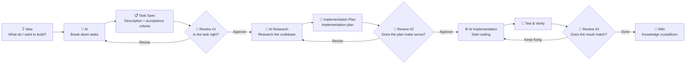

### Three key human review checkpoints

**01 — Review the spec**: before AI writes code, review the task description, acceptance criteria, and task boundaries.

**02 — Review the plan**: after the AI researches the codebase, it writes an implementation plan into the task; coding starts only after you approve it.

**03 — Review the result**: review the diff, run tests, check acceptance criteria, and verify the final outcome.

> **Humans own direction and judgment; AI owns decomposition and execution.**

---

## Quick Start

Install globally with npm — one command:

```sh
npm i -g @kuwork/backlog.md
```

> [!TIP]
> After installing, run `backlog --help`. Seeing the full command list means the install succeeded.

Initialize inside any Git repository:

```sh
# Initialize in a Git repo
backlog init "My Awesome Project"

# Or initialize without Git for local / non-code projects
backlog init "Personal Planning" --no-git
```

The init wizard asks how you want to connect AI tools:

- **CLI instructions** (recommended) — creates a short instruction file that tells agents to run `backlog instructions overview`.
- **MCP connector** — if you prefer MCP, it can auto-configure Claude Code, Codex, Gemini CLI, Kiro, or Cursor.
- **Skip** — no AI setup; use Backlog.md purely as a task manager.

Backlog data is stored in a project-local backlog folder such as `backlog/`, `.backlog/`, or a custom project-relative path configured through `backlog.config.yml`. Tasks remain human-readable Markdown files (for example `task-10 - Add core search functionality.md`). Git is optional: `backlog init --no-git` creates a filesystem-only project and disables cross-branch checks, remote operations, and auto-commit.

<details>
<summary><b>Other install options (bun / Homebrew / Nix / DeepSeek Harness)</b></summary>

```sh
# Bun
bun add -g @kuwork/backlog.md

# Homebrew (upstream)
brew install backlog-md

# Nix (upstream)
nix run github:MrLesk/Backlog.md
```

<p align="center">
<a href="https://github.com/deepseek-ai/deepseek-harness"><picture><source media="(prefers-color-scheme: dark)" srcset="https://raw.githubusercontent.com/kuwork/Backlog.md/main/.github/deepseek-harness-dark.svg" /></picture></a>
</p>

Also one command away in DeepSeek Harness: `dsh plugin --profile web add dsh-backlog.md` ([plugin repo](https://github.com/kuwork/DSH-Backlog.md)).

</details>

---

## Workflows

### Working with AI agents

This is the recommended flow for Claude Code, Codex, Gemini CLI, Kiro, and similar tools, following the spec-driven AI development approach. After running `backlog init`, agents should first run `backlog instructions overview`, then work in this loop.

**Step 1 — Describe your idea.** Tell the agent what you want to build and ask it to split the work into small tasks with clear descriptions and acceptance criteria.

> 🤖 **Ask your AI agent:**
>
> I want to add a search feature to the web view that searches tasks, docs, and decisions. Please decompose this into small Backlog.md tasks.

> [!NOTE]
> **Review checkpoint #1** — read the task descriptions and acceptance criteria.

**Step 2 — One task at a time.** Work on a single task per agent session, one PR per task. Good task splitting lets each session proceed independently without conflicts; keep tasks small enough to finish in one conversation so you do not run out of context window.

**Step 3 — Plan before coding.** Ask the agent to research the codebase and write an implementation plan in the task. Do this right before implementation so the plan reflects the current state of the codebase.

> 🤖 **Ask your AI agent:**
>
> Work on BACK-10 only. Research the codebase and write an implementation plan in the task. Wait for my approval before coding.

> [!NOTE]
> **Review checkpoint #2** — read the plan. Does the approach make sense? Approve it or ask for revisions.

**Step 4 — Implement and verify.** Let the agent implement the task.

> [!NOTE]
> **Review checkpoint #3** — review the code, run tests, check linting, and verify the results match your expectations.

If the output is not good enough: clear the plan / notes / final summary, refine the task description and acceptance criteria, and run the task again in a fresh session.

### Working without AI agents

Use Backlog.md as a standalone task manager from the terminal or browser:

```sh
# Create and refine tasks
backlog task create "Render markdown as kanban"
backlog task edit BACK-1 -d "Detailed context" --ac "Clear acceptance criteria"

# Track work
backlog task list -s "To Do"
backlog task edit BACK-1 --comment "Can we split the UI work into a separate PR?" --comment-author @sara
backlog task edit BACK-1 --remove-comment 2  # Remove comment #2; --clear-comments removes all comments
backlog search "kanban"
backlog board

# Work visually in the browser
backlog browser
```

You can switch between AI-assisted and manual workflows at any time — both operate on the same Markdown task files. It is recommended to modify tasks through Backlog.md commands (CLI / MCP / Web) rather than editing task files by hand, so field types and metadata stay consistent. Tasks can record project-root-relative modified files and later be found with `backlog search --modified-file src/path.ts --plain`. Use task comments for discussion and review notes; comment bodies support Markdown, but standalone `---` lines are reserved as comment delimiters. Use implementation notes for execution progress and the final summary for PR-style completion notes.

**Learn more:** [CLI reference](CLI-INSTRUCTIONS.md) ｜ [Advanced configuration](ADVANCED-CONFIG.md)

---

## Web UI

Launch a modern, responsive web interface for visual task management. It binds to the loopback address `127.0.0.1` by default; see [Security](#security) for LAN access and its risks.

```sh
# Start the web server (opens the browser automatically, local machine only)
backlog browser

# Custom port
backlog browser --port 8080

# Don't open the browser automatically
backlog browser --no-open

# Ignore existing caches and load everything from scratch (when the UI shows stale content)
backlog browser --no-cache

# Pin the rescan heartbeat to the bottom line (--no-status-line prints it as normal lines; BACKLOG_STATUS_LINE=1/0 is equivalent)
backlog browser --status-line

# Open with a specific browser via the BROWSER environment variable (common in devcontainers)
BROWSER="/path/to/browser" backlog browser
```

**Features:**

- Interactive kanban board with drag-and-drop
- Task creation and editing with rich forms
- Interactive acceptance criteria editor with checklists
- A table-of-contents (TOC) drawer inside task and document modals, with scrollspy highlight and auto-floating on narrow screens
- Real-time updates across all views
- Responsive design for desktop and mobile
- Task archiving with confirmation dialogs
- Seamless CLI integration — every change syncs to the Markdown files

### Gantt chart view

`backlog browser` includes a built-in Gantt chart view with five time granularities (day / week / month / quarter / year), implemented in pure React / CSS with zero external dependencies:

- **Planned time**: `plannedStart` / `plannedEnd` (`YYYY-MM-DD`) draws the planned border.
- **Actual time**: `actualStart` / `actualEnd` (`YYYY-MM-DD HH:MM` UTC) auto-populates on status changes, drawn as status-colored solid bars.
- **Tracking comparison**: the planned border and actual bar are overlaid on the same row, so delays and early starts are visible at a glance.
- **Dependency arrows**: SVG smart-connects task dependencies.

Date fields can be set or cleared directly from the CLI:

```sh
# Planned fields (date-only)
backlog task edit BACK-10 --planned-start 2026-06-01 --planned-end 2026-06-07 --due-date 2026-06-10

# Actual fields (date-time UTC), auto-populated on status change
backlog task edit BACK-10 --status "In Progress"  # actualStart auto-set to the current time

# Clear any task date field
backlog task edit BACK-10 --clear-due-date --clear-planned-start --clear-planned-end --clear-actual-start --clear-actual-end

# Clear milestone date fields
backlog milestone edit "Release 1.0" --clear-due-date --clear-planned-start --clear-planned-end
```

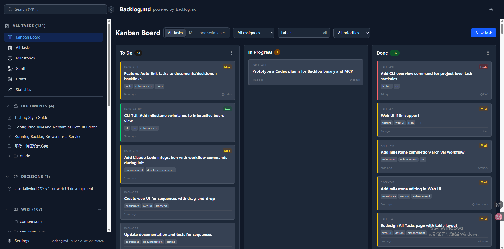


### TOC drawer

Task, wiki, and file modals include a bookmark-style outline: a narrow tab peeks from the modal's left edge, and clicking it expands a floating panel as tall as the modal. Entries are organized by region (description / acceptance criteria / plan / notes / comments), scrollspy highlights the active section while scrolling, and a click smooth-scrolls to it. When the panel edge is less than 300 px from the viewport, the drawer switches to floating mode so the outline stays usable on narrow windows.

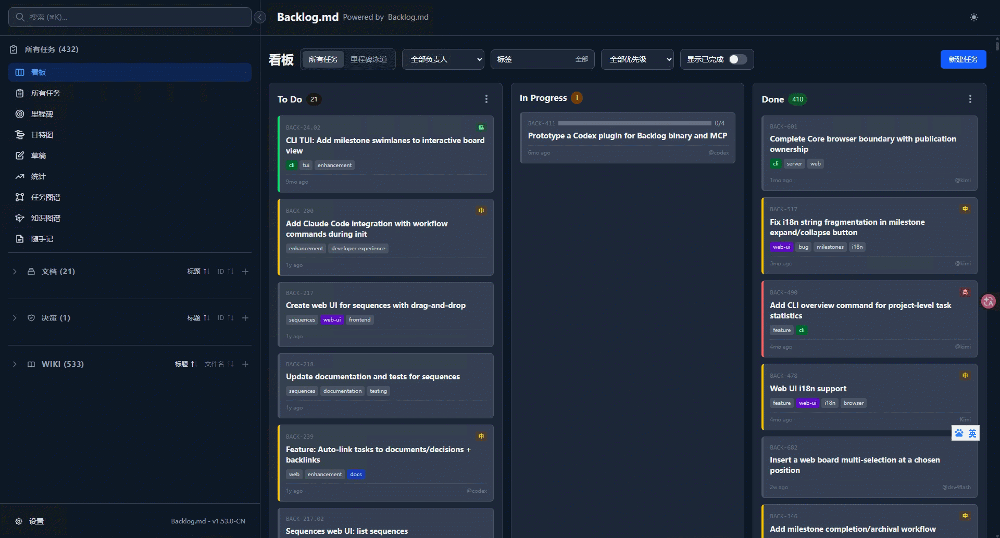

### Live SQL query blocks

Any Markdown body (tasks, documents, decisions, memos, wiki pages) can embed read-only query fenced blocks. The web UI's reading view **executes the query live** against the project's data sources and renders the result, while the editor keeps showing the raw source. SQL data uses `sqlite-query` / `duckdb-query` / `mdb-query`, and graph databases use `cypher-query`.

- `source` is a project-relative path: `.sqlite` / `.sqlite3` / `.db` for `sqlite-query`; `.duckdb`, `.csv`, and `.xlsx` for `duckdb-query` (CSV / Excel open an in-memory instance and read the file directly, with the Excel extension autoloaded); `.mdb` / `.accdb` for `mdb-query` (the Access file is loaded via mdb-reader into an in-memory SQLite instance that reuses the same query engine, and GBK / CP936 text is decoded into correct Chinese automatically).
- Read-only is enforced in three layers: a statement-shape allowlist, a keyword blocklist, and a physically read-only engine handle. Results are **capped at 500 rows by default** and flagged with `truncated` rather than silently dropping rows; the cap comes from the `queryMaxRows` config (default 500, hard ceiling 5000). Query blocks have no pagination, so tighten the query or raise the config when you need more rows.
- `view` supports `table` (default) / `list` / `value`; `duckdb-query` additionally accepts `copy_to: <path>` to export results as a CSV / Excel file inside the project.
- For `cypher-query`, the statement field is `query` rather than `sql`, and `source` is a database registry name rather than a path; it additionally supports `view: graph` (a force-directed view) and `refresh: auto` (re-run on graph hot updates). Write keywords (`CREATE` / `MERGE` / `SET` / `DELETE`, etc.) are rejected. Its row rules mirror the SQL blocks: capped at 500 rows by default via `queryMaxRows` with a hard ceiling of 5000, flagging `truncated` beyond the cap; `view: graph` falls back to a table when the result draws more than 3000 nodes.

<details>
<summary><b>Query block syntax examples</b></summary>

````markdown
```sqlite-query
source: backlog/databases/shop.sqlite
view: table
sql: |
  SELECT product, price, stock
  FROM inventory
  ORDER BY price DESC
```
````

````markdown
```cypher-query
source: default
view: graph
refresh: auto
query: |
  MATCH (t:FileNode)-[:DependsOn]->(d:FileNode)
  RETURN t, d
  LIMIT 50
```
````

</details>

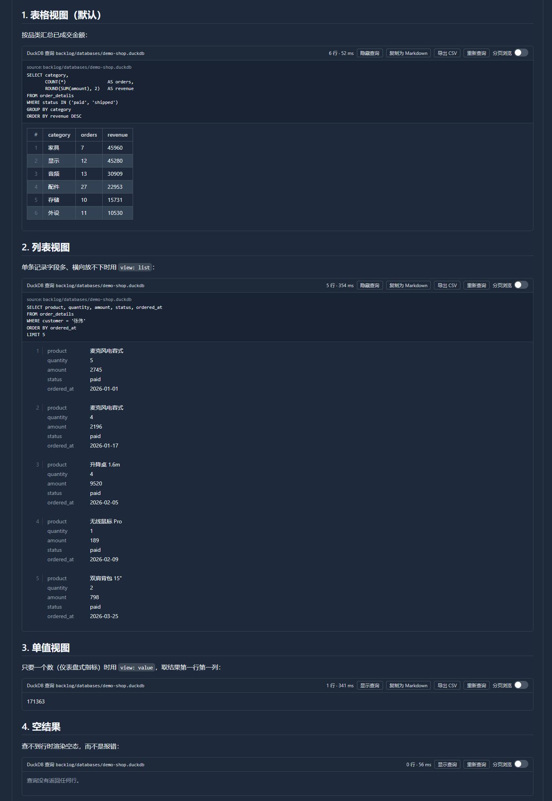

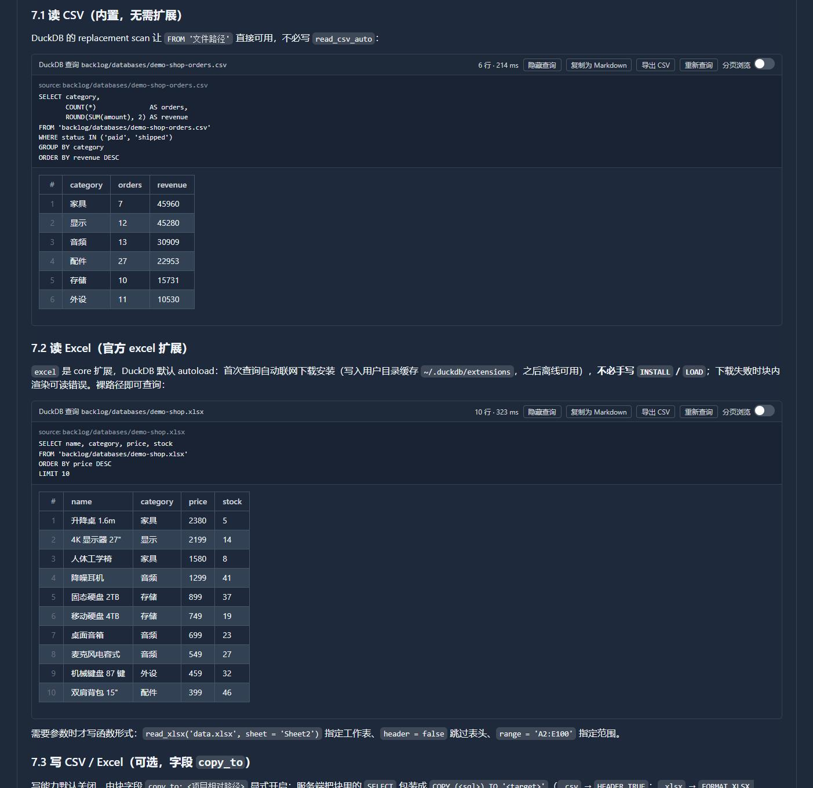

To keep the web UI running as an auto-starting local service, see [Running Backlog.md Browser as a Service](<backlog/docs/doc-003 - Running-Backlog-Browser-as-a-Service.md>).

### Office and PDF file preview

The web UI ships high-fidelity file preview so common office documents can be reviewed without leaving the app:

- 📄 **DOCX preview** — parses OOXML in the browser via `@eigenpal/docx-editor-react` (ProseMirror), restoring true pagination while preserving paragraphs, headings, tables, images, and styling.
- 📊 **XLSX preview** — renders spreadsheets via Univer 1.3.0 and SheetJS, with a hand-written OOXML style reader (fonts / fills / borders / number formats); supports both read-only and edit modes, writing edits back incrementally (only sheetData and mergeCells are regenerated, so style indexes stay intact).
- 📑 **PPTX preview** — renders slides via `@aiden0z/pptx-renderer`, with thumbnails, full-screen playback, and WPS-style shortcuts.
- 📕 **PDF preview** — renders PDF via pdf.js, with page navigation, zoom, and an outline.

All four previews include the bookmark-style outline described above: a slim tab peeks from the dialog's left edge, the floating panel supports scrollspy highlight and smooth scrolling, and it switches to floating mode when its edge is within 300 px of the viewport.

---

## Wiki Memos

### LLM Wiki knowledge base

Backlog.md includes an LLM-maintained **Wiki** that turns every human–AI pairing session into reusable, compounding knowledge.

The pairing flow:

> Human drives strategy → AI breaks down tasks → Pair execution → Knowledge automatically crystallizes into the Wiki

```text
Brainstorm → doc → AI planning → tasks → pair execution → wiki
```

| Layer | Location | Content | Owner |
| --- | --- | --- | --- |
| **Planning** | `backlog/docs/` | Strategy and technical specs | Human-led, AI-assisted |
| **Execution** | `backlog/tasks/` | Tasks and acceptance criteria | AI-created, human-reviewed |
| **Memory** | `backlog/wiki/` | Knowledge crystals and extracted patterns | AI-maintained, human-reviewed |

The Wiki is fully maintained by the LLM — no manual file creation needed. Backlog.md ships the workflow as the `llm-wiki-for-backlog` skill; once installed, the AI assistant recognizes the Wiki triggers:

```sh
backlog wiki install claude   # Claude Code / Claude Desktop
backlog wiki install codex    # OpenAI Codex CLI
backlog wiki install agents   # Generic agents directory
```

Use `--dry-run` to preview the steps and `--force` to overwrite an existing installation. Trigger the skill in conversation with these keywords:

| Trigger | Action |
| --- | --- |
| `build wiki` / `init wiki` | Initialize the Wiki directory structure and inject workflow guidelines |
| `ingest` / `process source` | Ingest backlog sources (tasks / docs / decisions, etc.) into the Wiki |
| `wiki query` | Query accumulated knowledge to answer questions or generate reports |
| `lint wiki` / `health check` | Scan for contradictions, orphan pages, and stale content |

The Wiki follows four principles — **informal, lightweight, AI-maintained, and challengeable**. It is not an enterprise knowledge base but your "pairing notebook" with the AI.

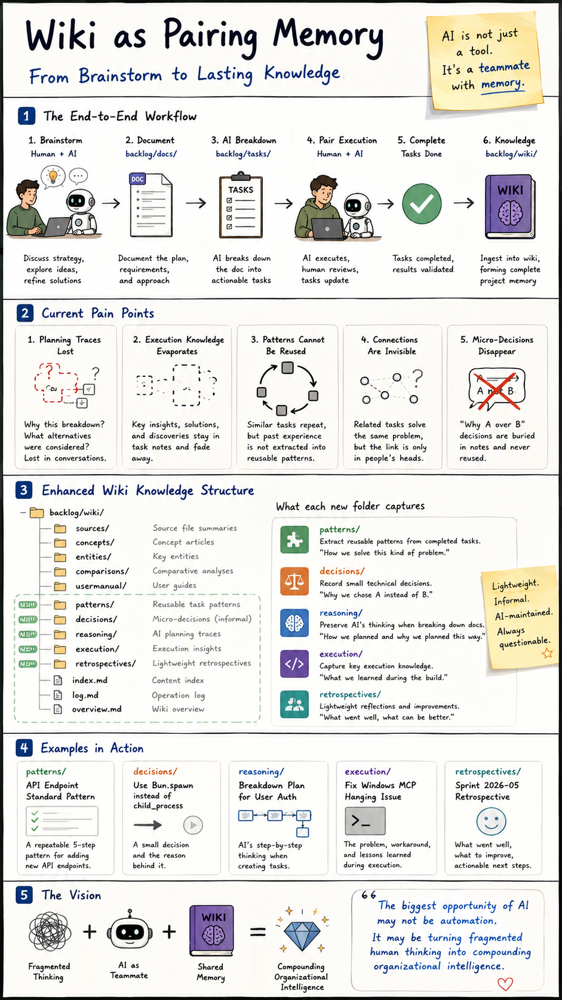

### Memos quick notes

Memos are Backlog.md's fifth file entity: lightweight, title-less notes stored as plain Markdown files under `backlog/memos/` (a `YYYYMMDD-N` date plus serial ID). They are included in global search, automatically linked into the knowledge graph, and generate backlinks.

- **Three views, one source** — switch between the feed, calendar (monthly navigation), and WebGL pinboard.
- **Full Markdown** — inline `#tags` and `@task` parsing, pasted images, and save with ⌘/Ctrl+Enter.
- **End-to-end** — the web UI, the `backlog memo` CLI subcommands, and MCP tools read and write the same storage.
- **Archiving** — hover a card to archive it into `backlog/archive/memos/`; history is preserved.

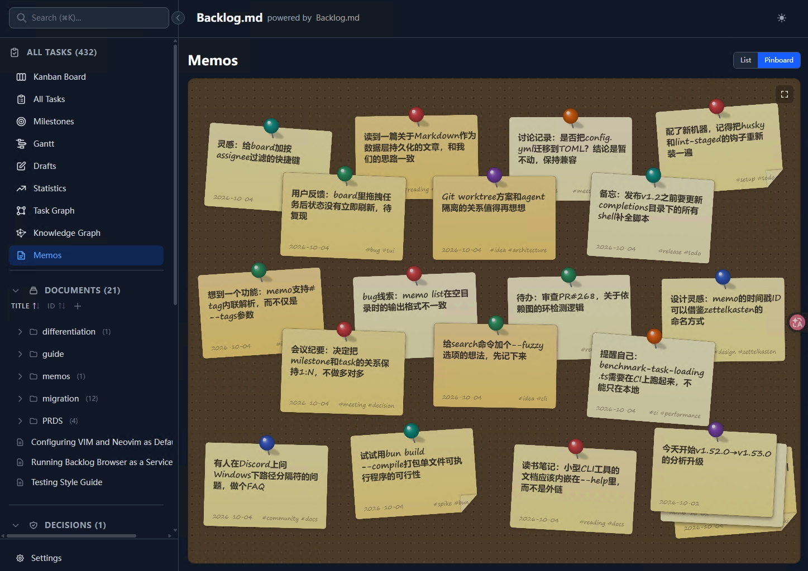

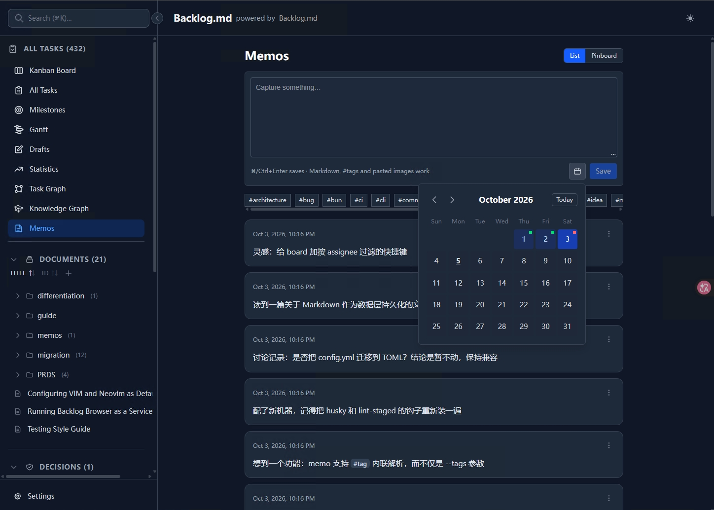

---

## Graph Queries

Tasks, documents, decisions, memos, and the dependencies / links / tags between them form a project graph. `backlog graph` runs **read-only Cypher queries** against it from the command line (the same graph behind the graph search in `backlog browser`), handy for ad-hoc analysis, scripting, or piping results into other tools:

```sh
# Inspect the graph structure (node / relationship tables)
backlog graph schema

# Find the tasks blocking the most other tasks
backlog graph query default "MATCH (t:FileNode)<-[:DependsOn]-(d:FileNode) RETURN t.title, count(d) AS blocked ORDER BY blocked DESC LIMIT 10"
```

- Queries are strictly read-only: write keywords are rejected, and neither the graph nor the Markdown corpus is ever modified.
- Each call rebuilds the graph in-process (a few seconds); `--json` prints machine-readable results.
- You can also create user databases with `backlog graph create` / `import` (stored under `backlog/databases/`) and load custom nodes and relationships from CSV.

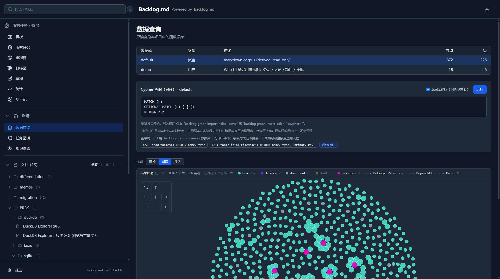

<details>
<summary><b>Custom graph databases and legend settings</b></summary>

`default` is the derived graph of the Markdown corpus (a read-only cache — writes are refused because the next rebuild would overwrite them). Writes only happen in **user databases** you create yourself:

```sh
# Create a database, then a schema and data
backlog graph create people "people and their relationships"
backlog graph insert people "CREATE NODE TABLE Person(name STRING PRIMARY KEY, age INT64)"
backlog graph insert people "CREATE (:Person {name: 'Alice', age: 30}), (:Person {name: 'Bob', age: 41})"

# Or import a CSV straight away: the first column is the key, re-importing updates (upsert)
backlog graph import people data/people.csv --node Person
# The same file can become edges: two endpoint columns matched against existing node keys
backlog graph import people data/knows.csv --rel KNOWS --from person --to friend --node Person

backlog graph query people "MATCH (a:Person)-[:KNOWS]->(b:Person) RETURN a.name, b.name"
```

- User databases persist as JSON snapshots under `backlog/databases/`; `insert` snapshots after every statement, and `import` validates the file before opening the database, leaving it untouched on errors.
- `list` / `describe` / `drop` manage the lifecycle; the web UI's **Databases** page lists every database and runs the same read-only Cypher.

**Legend and style settings**: the legend panel in the web UI's graph view is configured **per node type** — a caption template (`{{field}}`, auto-guessed from `name` / `title` and similar fields when empty), a base colour, and first-match-wins colouring rules. Quick methods such as equal-width bins, quantiles, thresholds, or by-value generate a rule set from one field that you then refine by hand. Relationship types get their own line style (solid / dashed / dotted / long), arrows, colour, and display name. Legend entries can be hidden individually and node captions switched off entirely; all settings persist per database in the browser.

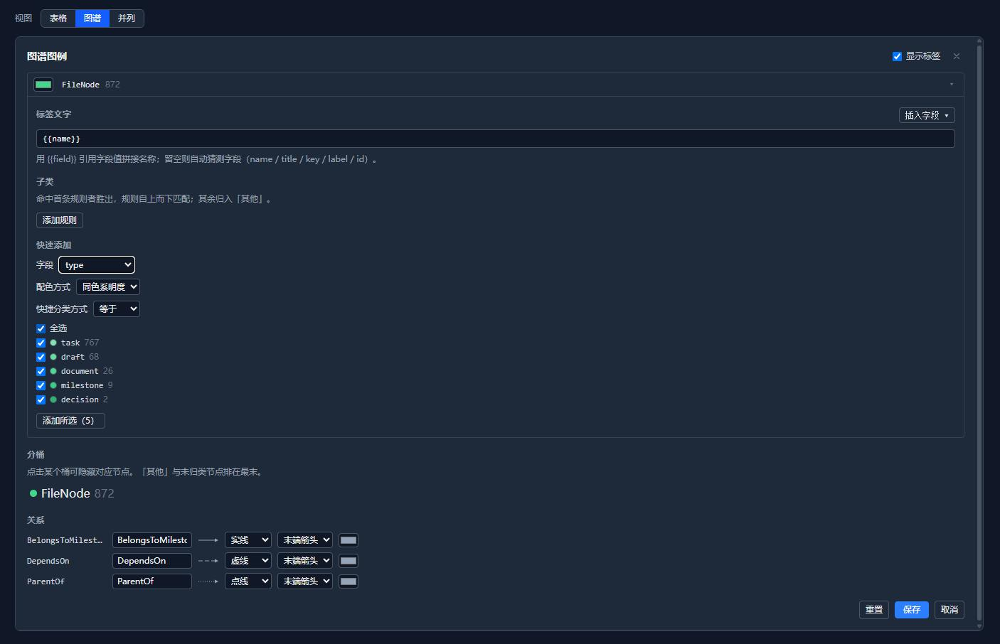

</details>

---

## MCP Integration

CLI instructions are the default AI integration method. If you prefer an MCP connector, Backlog.md still supports AI coding assistants such as Claude Code, Codex, Gemini CLI, and Kiro. Run `backlog init` (even if you already initialized Backlog.md) and choose MCP integration, or add the server manually with the client guides below.

<details>
<summary><strong>Claude Code</strong></summary>

```sh
claude mcp add backlog --scope user -- backlog mcp start
```

</details>

<details>
<summary><strong>Codex</strong></summary>

```sh
codex mcp add backlog -- backlog mcp start
```

</details>

<details>
<summary><strong>Gemini CLI</strong></summary>

```sh
gemini mcp add backlog -s user backlog mcp start
```

</details>

<details>
<summary><strong>Kiro</strong></summary>

```sh
kiro-cli mcp add --scope global --name backlog --command backlog --args mcp,start
```

</details>

Use the shared server name `backlog` everywhere. The server locates the active project from the client's MCP roots and re-resolves when you switch workspace or worktree. Until it finds one, it serves `backlog://init-required`; a single user-scope server covers every repository.

<details>
<summary><b>Manual configuration and BACKLOG_CWD</b></summary>

```json
{
  "mcpServers": {
    "backlog": {
      "command": "backlog",
      "args": ["mcp", "start"],
      "env": {
        "BACKLOG_CWD": "/absolute/path/to/your/project"
      }
    }
  }
}
```

Set `BACKLOG_CWD` to pin the server to one project and stop workspace following — use it to always target the same backlog, or when the client cannot report MCP roots. If your IDE supports custom args but not environment variables, you can instead pass `["mcp", "start", "--cwd", "/absolute/path/to/your/project"]`.

</details>

> [!IMPORTANT]
> When adding the MCP server manually, add a short instruction in your CLAUDE.md / AGENTS.md files telling the agent to read `backlog://workflow/overview`. This step is unnecessary with `backlog init`, which adds the instructions automatically. For CLI-based setups, run `backlog instructions overview` to fetch the current workflow guidance.

Once connected, agents can read the workflow instructions via `backlog://workflow/overview`, with detailed guides at `backlog://workflow/task-creation`, `backlog://workflow/task-execution`, and `backlog://workflow/task-finalization`. Use the `/mcp` command in your AI tool (Claude Code, Codex, Kiro) to verify the connection.

---

## Configuration

Backlog.md merges the following layers (highest to lowest priority):

1. CLI flags.
2. Project config file: `backlog.config.yml` when present, otherwise `backlog/config.yml` or `.backlog/config.yml`.
3. Built-in defaults.

### Interactive wizard (`backlog config`)

Run `backlog config` with no arguments to launch the full interactive wizard (the same experience as the advanced settings in `backlog init`). It walks through the entire configuration surface: cross-branch accuracy (`checkActiveBranches`, `remoteOperations`, `activeBranchDays`), Git workflow (`autoCommit`, `bypassGitHooks`), ID formatting (`zeroPaddedIds`), editor integration (`defaultEditor`), Definition of Done defaults, and web UI defaults (`defaultPort`, `autoOpenBrowser`).

Skipping the wizard applies the built-in safe defaults:

| Key | Default | Description |
| --- | --- | --- |
| `checkActiveBranches` | `true` | Enables cross-branch accuracy checks |
| `remoteOperations` | `true` | Allows remote operations |
| `activeBranchDays` | `30` | Number of days for active-branch statistics |
| `autoCommit` | `false` | Disables automatic Git commits on every write |
| `bypassGitHooks` | `false` | Does not bypass repository pre-commit hooks |
| `zeroPaddedIds` | disabled | Zero-padded task IDs are not used |
| `defaultEditor` | unset | Falls back to the editor in your environment |
| `defaultPort` | `6420` | Default web UI port |
| `autoOpenBrowser` | `true` | Opens the browser automatically when the web server starts |

For filesystem-only projects, `backlog init --no-git` does not run `git init`, and the saved configuration forces `checkActiveBranches=false`, `remoteOperations=false`, and `autoCommit=false` so CLI, web, and MCP local-file workflows do not depend on a Git repository. When you revisit `backlog init` or rerun `backlog config`, the wizard pre-fills prompts with your current values so you only adjust what changed.

### autoCommit

When enabled (`backlog config set autoCommit true` or `autoCommit: true` in the config file), each of the following writes produces **one Git commit**: task create / edit / bulk update, task archive / complete, draft promote / demote / archive, decision and document creation **and updates**, milestone archive / rename, and the AI instruction files written by `backlog init`.

<details>
<summary><b>autoCommit notes and commit message conventions</b></summary>

- **Each commit contains only the files that write touched** (new files plus replaced / moved old paths). It never stages the whole directory, never sweeps in or clears your other staged changes, and leaves untracked files untouched.
- **Git must be initialized.** Filesystem-only projects created with `backlog init --no-git` force autoCommit off.
- **A failed commit does not lose data**: the file is already on disk but simply not committed — inspect it with `git status` and commit manually; a failed milestone archive / rename automatically rolls back the file move.
- **`bypassGitHooks`**: auto-commits trigger repository pre-commit hooks by default, which can block on lint / format failures; set `backlog config set bypassGitHooks true` to skip them.
- **Commit messages**: tasks distinguish the operation (`Create task` / `Update task` / `Archive task`); decisions and documents distinguish creation from updates (`Add decision` / `Update decision`, `Add document` / `Update document`); milestones and drafts use the `backlog:` prefix.
- **Recommendation**: enable it for solo / automated workflows to get one commit per operation; keep it off (the default) with manual commits for collaborative work or fine-grained history control. The two modes never interfere.

</details>

### Definition of Done defaults

Set project-wide DoD items with `backlog config` (or the `backlog init` advanced setup), in the web UI (Settings → Definition of Done Defaults), or by editing the project config file directly:

```yaml
definition_of_done:
  - Tests pass
  - Documentation updated
  - No regressions introduced
```

When a project uses root config discovery, edit `backlog.config.yml` rather than `backlog/config.yml`. These items are added to every new task by default; add more at creation time with `--dod`, or disable the defaults for a single task with `--no-dod-defaults`.

For the full configuration reference (every option, command, and detail), see [ADVANCED-CONFIG.md](ADVANCED-CONFIG.md). The full command reference lives in [CLI-INSTRUCTIONS.md](CLI-INSTRUCTIONS.md), and `backlog --help` is always available.

---

## FAQ

### Can I use Backlog.md without initializing Git?

Yes. Run `backlog init --no-git` to create a filesystem-only project. It disables cross-branch checks, remote operations, and auto-commit, so the CLI, web, and MCP workflows do not depend on a Git repository.

### Can I edit task Markdown files by hand?

Prefer changing tasks through Backlog.md commands (CLI / MCP / Web) rather than hand-editing files, so field types and metadata stay consistent. You can switch between AI-assisted and manual workflows at any time; both read and write the same Markdown task files.

### How do I access the web UI from my LAN?

Use `backlog browser --host 0.0.0.0` to allow LAN access, but the API has **no authentication**, so never expose it on an untrusted network. The default `127.0.0.1` binding is reachable only from the local machine. See [Security](#security) for the full boundary.

### The web UI shows stale content. What do I do?

Run `backlog browser --no-cache` to ignore existing caches and load everything from scratch. Under normal circumstances the web view updates live as files change.

### Will a failed autoCommit lose my data?

No. The file has already been written to disk; only the commit was not created. Inspect it with `git status` and commit manually. A failed milestone archive / rename also rolls back the file move automatically.

### What causes "illegal hardware instruction" on Apple Silicon?

In short, Node / Bun / Homebrew are running under Rosetta and installed the Intel binary instead of the arm64 one, so the architectures do not match. Reinstalling with the native arm64 build fixes it.

<details>
<summary><b>Architecture diagnostics and reinstall commands</b></summary>

First check what each tool reports:

```sh
uname -m                            # arm64 = Apple Silicon hardware; x86_64 = Intel or a Rosetta shell
node -p process.arch                # Architecture of your Node/Bun runtime
sysctl -in sysctl.proc_translated   # 1 = the current shell runs under Rosetta
which brew                          # /opt/homebrew = arm64 brew, /usr/local = Intel brew
```

If the architectures disagree, reinstall with the native one:

```sh
# Homebrew: make sure which brew prints /opt/homebrew, then (upstream)
brew reinstall backlog-md

# npm
arch -arm64 npm i -g @kuwork/backlog.md

# Bun
arch -arm64 bun add -g @kuwork/backlog.md
```

Running an x64 Node under Rosetta on purpose also works: `backlog` falls back to whichever `backlog.md-darwin-*` package is present.

</details>

---

## Security

> [!CAUTION]
> Backlog.md is local-first and offline: data lives inside your project repository, there is no forced cloud account or subscription, and task data is never sent anywhere. Be aware of the following boundaries for the web server and query features.

- **The web server binds to the loopback address `127.0.0.1` by default**, reachable only from the local machine. `--host 0.0.0.0` opens LAN access but the API is **unauthenticated**; exposing it on an untrusted network is equivalent to letting anyone on the segment read and write tasks, so protect it with a firewall or tunnel.
- **Live query blocks are strictly read-only**: SQL blocks are guarded by a statement-shape allowlist, a keyword blocklist, and a physically read-only engine handle. Both SQL and Cypher blocks cap results at 500 rows by default (configurable via `queryMaxRows`, hard ceiling 5000) and only flag `truncated` beyond the cap; Cypher blocks additionally reject write keywords such as `CREATE` / `MERGE` / `SET` / `DELETE`.
- **The `default` graph is a read-only cache** derived from the Markdown corpus; writes are refused and a rebuild overwrites everything. Only user databases you explicitly create (`backlog/databases/`) accept writes.
- **MCP and CLI operate on local files**: auto-commit (`autoCommit`) is off by default; when enabled, each write creates a Git commit containing only the files that write touched.

---

## Community Tools

- **[vscode-backlog-md](https://marketplace.visualstudio.com/items?itemName=ysamlan.vscode-backlog-md)** — VS Code extension with an issues panel, kanban view, and editing. ([ysamlan/vscode-backlog-md](https://github.com/ysamlan/vscode-backlog-md))
- **[dsh-backlog.md](https://github.com/kuwork/DSH-Backlog.md)** — a DeepSeek Harness (DSH) bundle plugin that embeds the local `backlog browser` board into Harness through a sidebar panel, a conversation tab, and a session-header menu. Each workspace runs its own board process with automatic port avoidance, the `backlog` CLI is installed automatically when missing, and no Harness code is modified. Install with `dsh plugin --profile web add dsh-backlog.md` ([npm package](https://www.npmjs.com/package/dsh-backlog.md)).

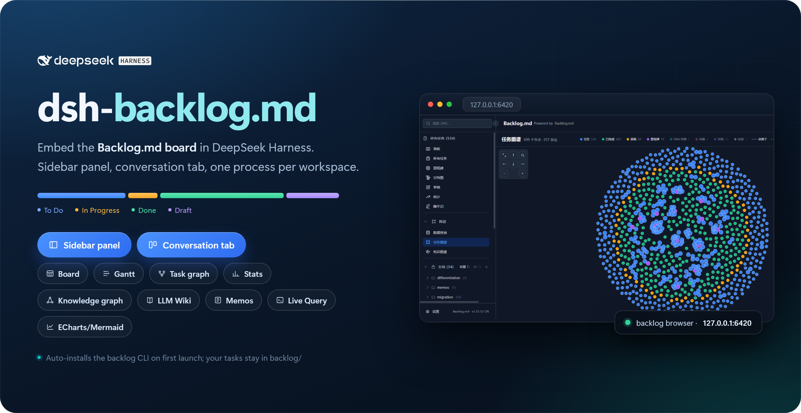

*dsh-backlog.md adds a persistent sidebar entry and a conversation tab inside DeepSeek Harness, with a board process started and stopped independently per workspace.*

---

## License

Backlog.md is released under the **MIT License** — do anything, just give credit. See [LICENSE](LICENSE) for the full terms.

<p align="right"><a href="#readme-top">↑ Back to top</a></p>
