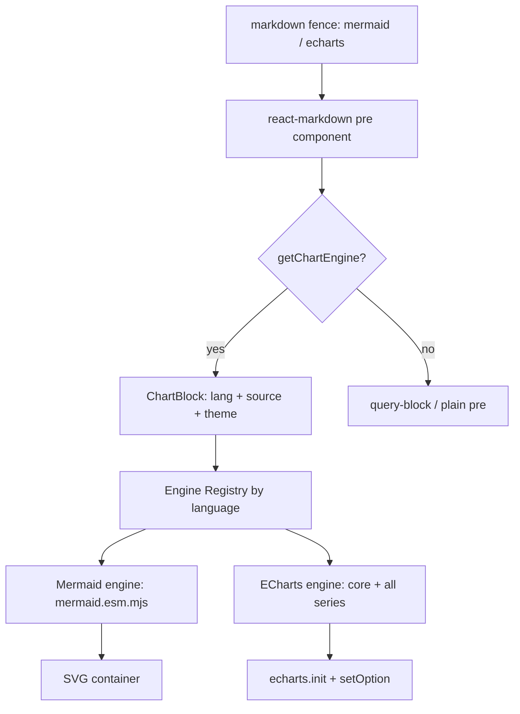

# ECharts 图表引擎设计（统一 ChartBlock + 引擎注册表）

> 状态：设计稿（待评审）
> 范围：Web 端 markdown 渲染（与现有 mermaid 一致）
> 关联：back-317（Mermaid 渲染）、back-640（Mermaid 渲染 bug）

---

## 1. 背景与现状

项目当前已支持 Mermaid 图表，集成点位于 Web 端：

| 接入点 | 位置 | 方式 |
|---|---|---|
| 文档正文渲染 | `src/web/components/MermaidMarkdown.tsx:517` | 渲染后 `renderMermaidIn` 扫 DOM 替换 |
| 编辑器预览 | `src/web/components/PasteAwareMDEditor.tsx:110` → `MermaidAwarePre` | react-markdown `pre` 组件级 |
| 独立渲染 | `src/web/components/StateMachineEditor.tsx:490` → `<MermaidDiagram>` | React 组件 |
| 引擎加载 | `src/web/utils/mermaid.ts:68` | 动态 `import("mermaid/dist/mermaid.esm.mjs")` |

补充说明（评审时易被误读的点）：

- **post-render DOM 替换 vs 组件级路由并非错误设计。** query-block（sqlite/duckdb/cypher）走 `PreBlock` 组件级是因为它们是*交互式*结果块（跑查询、取数、切 view）；mermaid 是纯无状态“文本→SVG”，post-render 替换轻量且有意做了 `if (codeBlocks.length === 0) return` 的跳过优化。两条路径各自合理。
- 唯一真实成本：`renderMermaidIn` 替换了 react 拥有的 DOM 节点，导致主题切换时须整棵 markdown 重挂载（`MermaidMarkdown.tsx:782` 的 `key={theme}`，注释明确写明原因）。这是 post-render 模式特有的修补，组件级路由没有。
- mermaid 本身**已有**组件级路径 `MermaidDiagram`，只是 `MermaidMarkdown` 没把它接进 `PreBlock`。

结论：现有方式**可用、不需纠正**。下面的设计是为了**新增 echarts 并把多引擎收口到一个入口**，而不是修 mermaid 的 bug。

---

## 2. 目标

1. 在保留 Mermaid 的前提下，**新增 ECharts 图表支持**。
2. **覆盖面最大化**：mermaid 图类型 ∪ echarts 全部内置 series ∪ 未来可插拔引擎（PlantUML / D3 / vega）。
3. 多引擎共用**一个**渲染入口（`ChartBlock`），消除当前 mermaid 散落在 3+ 处的重复。
4. 遵循现有安全与主题约定（暗色模式自动跟随、不引入 XSS 面）。

---

## 3. 设计

### 3.1 核心抽象：ChartEngine + 注册表

```ts
// src/web/charts/types.ts
export interface ChartRenderContext {
  container: HTMLElement;
  source: string;
  mode: "light" | "dark";
}
export interface ChartEngine {
  id: string;
  /** 拥有的 fence 语言，大小写不敏感 */
  languages: string[];
  /** 惰性加载渲染器，内部缓存 */
  load(): Promise<ChartRenderer>;
}
export interface ChartRenderer {
  render(ctx: ChartRenderContext): Promise<void>;
  dispose?(container: HTMLElement): void;
}

// src/web/charts/registry.ts
const engines = new Map<string, ChartEngine>();
export const registerChartEngine = (e: ChartEngine) =>
  e.languages.forEach((l) => engines.set(l.toLowerCase(), e));
export const getChartEngine = (lang: string) => engines.get(lang.toLowerCase());
```

`ChartBlock` 不关心具体引擎，只做：查注册表 → 惰性 `load()` → `render()` → 卸载 `dispose()`。

```tsx
// src/web/components/ChartBlock.tsx（新增）
function ChartBlock({ lang, source }: { lang: string; source: string }) {
  const ref = useRef<HTMLDivElement>(null);
  const mode = useOptionalTheme();
  useEffect(() => {
    const el = ref.current;
    if (!el) return;
    let cancelled = false;
    let renderer: ChartRenderer | null = null;
    const frame = requestAnimationFrame(async () => {
      const engine = getChartEngine(lang);
      if (!engine) return;
      renderer = await engine.load();
      if (!cancelled) await renderer.render({ container: el, source, mode });
    });
    return () => {
      cancelled = true;
      cancelAnimationFrame(frame);
      if (renderer && ref.current) renderer.dispose?.(ref.current);
    };
  }, [lang, source, mode]);
  return <div ref={ref} className="chart-block" />;
}
```

### 3.2 渲染路径（mermaid 现状对照）



### 3.3 ECharts 引擎实现要点（覆盖最多类型）

用 `echarts/core` 的 tree-shaking 入口，**显式 use() 全部内置 series + 必要组件**：

```ts
import * as echarts from "echarts/core";
import { BarChart, LineChart, PieChart, ScatterChart, RadarChart, HeatmapChart,
  CandlestickChart, GaugeChart, GraphChart, TreeChart, TreemapChart, SunburstChart,
  ParallelChart, SankeyChart, FunnelChart, BoxplotChart, EffectScatterChart,
  LinesChart, PictorialBarChart, ThemeRiverChart, CustomChart, MapChart } from "echarts/charts";
import { GridComponent, TooltipComponent, LegendComponent, DataZoomComponent,
  VisualMapComponent, TitleComponent, DatasetComponent, GeoComponent,
  MarkPointComponent, MarkLineComponent, ToolboxComponent, AxisPointerComponent } from "echarts/components";
import { CanvasRenderer } from "echarts/renderers";
echarts.use([/* 以上全部 */]);
```

- **源格式**：fence 内放标准 ECharts `option` 的 **JSON**。原生 `option` 覆盖所有 series，零学习成本，且支持 `dataset` / `series` 混排。
- **主题**：`echarts.init(dom, mode === "dark" ? "dark" : undefined)`，或注册贴合 app 配色的自定义 theme；与 mermaid 的 `MERMAID_THEME_BY_MODE`（`mermaid.ts:38`）同源来自 `useOptionalTheme()`。
- **生命周期**：`init → setOption(JSON.parse(source)) → ResizeObserver.resize → dispose`，比 mermaid 全局 `initialize()` 更干净，且天然支持主题切换（无需 `key={theme}` 重挂载）。
- **安全**：只 `JSON.parse`，**禁止**把 option 当 JS 执行（函数式 option = XSS 风险）；与 mermaid `securityLevel:"strict"`（`mermaid.ts:83`）对齐。
- **可再扩展**：`echarts-gl`（3D）、`echarts-wordcloud`、`liquidfill` 作为“额外引擎/插件”，按同一注册表惰性 `import()`，按需加、不进首屏。
- **体积**：`import()` 动态加载，echarts 进独立 chunk，沿用 mermaid 的 prebuilt 动态加载思路，不进首屏。

### 3.4 接入点收敛

| 现状 | 位置 | 改造后 |
|---|---|---|
| post-render DOM 替换 | `MermaidMarkdown.tsx:517` `renderMermaidIn` | **可选**：若把 mermaid 也折进 `ChartBlock`，可移除并去掉 `key={theme}` 重挂载 |
| `PreBlock` 路由 | `MermaidMarkdown.tsx:432` | 顶部加 `if (getChartEngine(lang)) return <ChartBlock …/>`，再落 query-block |
| 编辑器预览 | `PasteAwareMDEditor.tsx:110` `MermaidAwarePre` | 改名 `ChartAwarePre`，查注册表 |
| 独立渲染 | `StateMachineEditor.tsx:490` `<MermaidDiagram>` | 改用 `<ChartBlock lang="mermaid">` |

> 决策点（非阻塞）：mermaid 是否一并折进 `ChartBlock`？
> - **最小改动（推荐 v1）**：echarts 走 `ChartBlock`，mermaid 维持 `renderMermaidIn` 现状。零风险。
> - **彻底统一**：mermaid 也注册为引擎，移除 `renderMermaidIn` 与 `key={theme}` 重挂载 hack。更整洁但需回归 back-640 相关渲染路径。

---

## 4. 范围决策

- **A. 仅 Web（与现状一致）**：按本文档即可落地，工作量小。
- **B. 含导出 / CLI / MCP**：markdown→HTML/PDF 或 MCP 富文本也需渲染图表，需 SSR 路径——echarts 官方 SSR（`setPlatformAPI` / SVG 字符串输出），mermaid 靠 `@mermaid-js/mermaid-cli` 或同款 wasm。建议作为独立任务（图表 SSR/导出）挂在 Web 支持之后。

**建议：先 A 后 B。**

---

## 5. 使用指南（建成后如何使用 ECharts）

> 本节面向**内容作者**：在任意支持 markdown 渲染的页面（文档、决策、wiki、memo、任务正文）里插入代码块即可。

### 5.1 基本语法

用 `echarts` 作为 fence 语言，块内写**标准 ECharts `option` 的 JSON**：

```echarts
{
  "title": { "text": "本周任务完成情况" },
  "tooltip": {},
  "xAxis": { "type": "category", "data": ["周一", "周二", "周三", "周四", "周五"] },
  "yAxis": { "type": "value" },
  "series": [
    { "name": "完成数", "type": "bar", "data": [3, 5, 2, 8, 6] }
  ]
}
```

渲染出的就是一张可交互柱状图（tooltip、坐标轴、缩放均可用）。

### 5.2 主题自动跟随

无需任何配置：图表随 App 的**明/暗模式**自动切换（与 mermaid 行为一致）。在暗色模式下，echarts 使用内置 `dark` 主题；如需品牌色，后续可注册自定义 theme。

### 5.3 支持的图表类型（v1 内置）

下列 series 类型开箱即用（在 `series[].type` 填对应值）：

| 类型 type | 说明 | 类型 type | 说明 |
|---|---|---|---|
| `bar` | 柱状图 | `line` | 折线图 |
| `pie` | 饼图 | `scatter` / `effectScatter` | 散点图 |
| `radar` | 雷达图 | `heatmap` | 热力图 |
| `gauge` | 仪表盘 | `funnel` | 漏斗图 |
| `sankey` | 桑基图 | `tree` / `treemap` | 树图 / 矩形树 |
| `sunburst` | 旭日图 | `graph` | 关系图 |
| `map` | 地图 | `parallel` | 平行坐标 |
| `candlestick` | K 线图 | `boxplot` | 箱线图 |
| `lines` | 路径线 | `pictorialBar` | 象形柱 |
| `themeRiver` | 主题河流 | `custom` | 自定义系列 |

> 与 mermaid 的分工：**mermaid 用 DSL 画结构/关系图**（流程图、时序图、甘特图、状态机…）；**echarts 用 JSON option 画数据图**（指标、分布、趋势）。两者互补，不重叠。

### 5.4 常用示例

**折线图（趋势）**

```echarts
{
  "title": { "text": "燃尽图（示例）" },
  "tooltip": { "trigger": "axis" },
  "xAxis": { "type": "category", "data": ["D1","D2","D3","D4","D5"] },
  "yAxis": { "type": "value" },
  "series": [
    { "name": "剩余", "type": "line", "data": [20, 16, 11, 7, 0], "smooth": true }
  ]
}
```

**饼图（占比）**

```echarts
{
  "title": { "text": "任务状态分布" },
  "tooltip": {},
  "legend": { "data": ["待办","进行中","完成"] },
  "series": [
    { "type": "pie", "radius": "55%",
      "data": [
        { "name": "待办", "value": 12 },
        { "name": "进行中", "value": 7 },
        { "name": "完成", "value": 25 }
      ] }
  ]
}
```

**多 series 组合（柱 + 线）**

```echarts
{
  "tooltip": { "trigger": "axis" },
  "legend": { "data": ["计划","实际"] },
  "xAxis": { "type": "category", "data": ["W1","W2","W3","W4"] },
  "yAxis": { "type": "value" },
  "series": [
    { "name": "计划", "type": "bar", "data": [10, 20, 30, 40] },
    { "name": "实际", "type": "line", "data": [8, 23, 28, 45] }
  ]
}
```

### 5.5 限制与约定

- **仅 JSON，不支持 JS 函数表达式。** 即 `series` 内的 `formatter` 等若需函数则不可用；这是有意的 XSS 防护。需要动态文本时用 ECharts 模板字符串（如 `"{b}: {c}"`）。
- **数据为内联静态 JSON**。v1 不支持直接引用 query-block 的查询结果（sqlite/duckdb/cypher）；该联动作为后续增强。
- **容器高度**：图表默认填满父容器宽度；建议在块前/后用空行隔离，避免与正文贴边。
- **非法 JSON / 未知 series**：渲染失败时回退为普通代码块（展示原始文本），不崩溃。

---

## 6. 实施步骤（建议任务拆分）

1. `src/web/charts/types.ts` + `registry.ts`：定义接口与注册表。
2. `src/web/charts/echarts-engine.ts`：实现 `load()`（注册全部 series/components）、`render()`、`dispose()`。
3. `src/web/components/ChartBlock.tsx`：通用渲染组件。
4. `src/web/components/MermaidMarkdown.tsx`：`PreBlock` 顶部加 ChartBlock 路由（v1 保留 `renderMermaidIn`）。
5. `src/web/components/PasteAwareMDEditor.tsx`：`MermaidAwarePre` → `ChartAwarePre`。
6. `src/web/components/StateMachineEditor.tsx`：`<MermaidDiagram>` → `<ChartBlock lang="mermaid">`（或保留）。
7. `package.json`：加 `echarts` 依赖（tree-shaking 入口）。
8. 测试：新增 `src/test/echarts-chartblock.test.tsx`（渲染、主题切换、非法 JSON 回退）。

DoD：Web 端 ` ```echarts ` 块可渲染全部内置 series；明暗主题跟随；非法输入回退代码块；编辑器预览与正文一致。

---

## 7. 风险与回滚

- **首屏体积**：echarts 动态 `import()` 隔离，不影响首屏；若担心可进一步按 series 拆 chunk。
- **回归 mermaid**：v1 不改动 `renderMermaidIn`，mermaid 行为不变；仅新增路径。
- **主题一致性**：若自定义 theme 与 app 配色偏差，先退回内置 `dark`/`light` 主题。

---

## 8. 增强设想：ECharts 直接引用 query-block 查询结果

> 状态：预研设想（v1 之后）。v1（第 5.5 节）明确不支持此联动；本节是后续增强的方案预演，供评审。

### 8.1 动机

v1 的 echarts 数据是**内联静态 JSON**。最自然的用法是「跑一条 SQL / Cypher → 图表直接出结果」，免去手工把查询结果抄进 option。这要求把 query-block 的执行结果暴露给*同一篇 markdown* 内的 echarts 块。

### 8.2 现状约束（已查源码）

- 结果只存在于 `SqlQueryBlock` 的 `useState<State>`（`SqlQueryBlock.tsx:256`）；cypher 是 thin wrapper，复用同一核心（`CypherQueryBlock.tsx:7` import `SqlQueryBlock`）。
- 结果数据形状（`src/web/lib/api.ts`，`SqliteQueryResult`）：`columns: string[]` + `rows: SqliteCell[][]`；`SqliteCell = string | number | boolean | null`；另有 `truncated` / `totalRows` / `page` / `pageSize` 等。
- **当前没有跨块共享 store**：grep `QueryResultStore / useQueryResult / registerQuery` 无命中，每块结果互不可见。
- query-block 字段自 BACK-811 起 **fail-closed**：未知字段直接报错并列出允许字段。因此新增 `id` 必须在 parser 显式允许，不能"偷偷"加。

### 8.3 两种集成方式

把"引用查询结果"做成两条互补路径，并与现有 query-block 的 `view`（`table` / `list` / `value` / `graph`）范式对齐。

#### 8.3.A 方式 A — 松耦合：echarts 块引用命名 query-block

保留让一个独立 `echarts` 块引用某 query-block 结果的做法，适合「一查询多图 / 图与数据源分离排版」。

1. **命名 query-block**：给三类 query-block 增加可选 `id` 字段（在 `src/sqlite/block.ts`、`src/graph/block.ts` 的 parser 中显式允许）。无 `id` 的块行为与现在完全一致（不注册，零回归）。
2. **新增 `QueryResultRegistry`**：一个轻量 React Context（Provider 挂在阅读视图根，如 `MermaidMarkdown` 的 markdown body 外层）。query-block 执行成功后 `registry.set(id, { columns, rows })`；重新执行/卸载时更新。`echarts` 块通过 `id` 读值并订阅变化。
3. **echarts option 引用语法**：在 option JSON 里用约定键引用，例如按 dataset 整取：
   ```json
   { "dataset": { "fromQuery": "my-query" } }
   ```
   或系列级按字段映射：
   ```json
   { "series": [ { "type": "bar", "fromQuery": "my-query", "categoryField": "day", "valueField": "count" } ] }
   ```
   引擎在 `JSON.parse` 之后、`setOption` 之前，递归把 `fromQuery` 解析为真实 `dataset.source`（对象数组或二维数组）。**仍是 `JSON.parse`，不执行任何函数**，XSS 面与 v1 一致。
4. **生命周期与依赖序**：echarts 块订阅 registry。query-block 异步取数回来后 registry 触发回调 → echarts 重新 `setOption`。echarts 块初始无需等待：注册表为空时先渲染占位/空图，结果到达即更新，与现有 `useEffect` 惰性 `load()` 模式一致。
5. **作用域（两层，须分清）**：
   - **id 命名空间**：`id` 仅在**所在文档内**需唯一；不同文档可重用同一 `id` 而**不冲突**——因为 registry 是每篇文档独立的 React Context 实例，互不可见。
   - **引用可达性**：`fromQuery` 只能引用**同一篇** markdown 内已命名的 query-block。跨文档/跨页面的引用**不在本增强范围**（需全局 store + 后台执行编排），本文不展开。
   - **同篇重复 id**：若同一文档内两个 query-block 声明相同 `id`，`QueryResultRegistry.set` 时检测并告警（后写覆盖前者），避免静默串数据。
6. **错误处理**：引用的 `id` 不存在 → 渲染提示「未找到查询 id: xxx」，不崩溃；query 本身出错 → 该 id 不更新，echarts 保持上次值或占位。

#### 8.3.B 方式 B — 紧耦合：query-block 内联 echarts view（类 table 的「值」视图）

让 query-block 自身携带一种 chart view，执行后**直接把结果渲染成图**——不需要单独的 `echarts` 块，也**不需要保留一个仅作数据源的可见块**。这与现有 `view: table` / `view: list` / `view: value` / `view: graph` 完全同构：cypher 的 `view: graph` 本就是在 query-block 内用 `result` 画图（`CypherQueryBlock.tsx:39` 的 `graph.fromResult`）。

1. **扩展 `view` 枚举**：在 `parseQueryBlock` / `parseCypherQueryBlock` 的 `view` 增加 `"echarts"`，并新增可选 `chart` 字段承载图表配置。无 `chart` / 未声明 `view: echarts` 的块行为不变。
2. **`chart` 配置两种写法（由简到繁）**：
   - 简单映射式（推荐，零 JSON 负担，类比 table view 自动把 `columns`/`rows` 出表）：
     ```sql-query
     source: mydb
     sql: SELECT day, cnt FROM tasks GROUP BY day
     view: echarts
     chart:
       type: bar
       categoryField: day
       valueField: cnt
       title: 每日任务数
     ```
   - 高级完整式（需自定义坐标轴 / 多 series / 复杂布局时，写标准 echarts `option`）：在 `chart.option` 内写任意 echarts option，用两种占位引用**本查询**结果——`@result` 注入整张结果（对象数组），`@result:<列名>` 注入某一列（值数组）。引擎在 `JSON.parse` 之后、setOption 之前对 option 树做深度遍历，凡字符串值匹配 `@result` 或 `@result:<列>` 则替换为真实数据，仍不执行函数。
     ```sql-query
     source: mydb
     sql: SELECT day, done, todo FROM tasks GROUP BY day
     view: echarts
     chart:
       option:
         title: { text: 每日完成与待办 }
         tooltip: { trigger: axis }
         legend: { data: [完成, 待办] }
         xAxis: { type: category, data: "@result:day" }
         yAxis: { type: value }
         series:
           - { name: 完成, type: bar, data: "@result:done" }
           - { name: 待办, type: line, data: "@result:todo" }
     ```
     等价地，也可用 `dataset.source: "@result"` 整表注入、再用 `encode` 映射列：
     ```sql-query
     source: mydb
     sql: SELECT day, cnt FROM tasks GROUP BY day
     view: echarts
     chart:
       option:
         dataset:
           source: "@result"
         xAxis: { type: category }
         yAxis: { type: value }
         series:
           - { type: bar, encode: { x: day, y: cnt } }
     ```
     > **列→坐标轴如何确定**：`dataset.source: "@result"` 只负责把整张结果（对象数组 `[{day, cnt}, …]`）灌进图表，**并不自动分配坐标轴**。哪一列作 x 轴、哪一列作 y 轴由 `series.encode` 显式声明——`encode: { x: day, y: cnt }` 表示 x 轴取 `day` 维度、y 轴取 `cnt` 维度（`day`/`cnt` 即对象数组的字段名）。若省去 `encode`，echarts 会按维度顺序（第 0、1 列…）默认分配，但类目轴仍需明确，故推荐显式写 `encode`。这与方式 1（直接把 `@result:day` / `@result:cnt` 写进 `xAxis.data` / `series.data`）是同一种「列→轴」的显式映射，只是声明位置不同。
     > 判别：parser 见 `chart.type` → 走简单映射式；见 `chart.option` → 走高级完整式。两者互斥。
3. **渲染分支**：在 `SqlQueryBlock` body 增加 `view === "echarts"` → 渲染 `<EchartsFromResult result={state.result} chart={parsed.block.chart} mode={theme} />`。复用 echarts 引擎的 `use()` + `init/setOption/dispose`，把 `result.columns`/`result.rows` 转成 `dataset.source`（对象数组或二维数组）；简单映射式按 `categoryField`/`valueField` 自动拼 series，高级式把 `@result` 替换为真实数据。
4. **生命周期**：与 graph view 一致——`result` 就绪后 init，依赖 `result`/`chart`/`theme` 变化时 `setOption`，`ResizeObserver` resize，卸载 dispose。**无需 registry、无需 `fromQuery`、无需可见的数据源块**。
5. **安全**：`chart` 是声明式映射或受控 option，仍 `JSON.parse`、不执行函数；XSS 面与 v1 一致。

#### 8.3.C 两种方式对比与推荐

| 维度 | 方式 A（松耦合） | 方式 B（紧耦合 / `view: echarts`） |
|---|---|---|
| 数据源块是否需可见 | 需（且其 `id` 被引用） | **不需**（块自身即图） |
| 语法 | 独立 ```` ```echarts ```` 块 + `fromQuery` | query-block 内 `view: echarts` + `chart` |
| 一查询多图 | 支持（多个 echarts 块引同一 `id`） | 不支持（一查询一图） |
| 与现有 `view` 范式 | 新机制 | 同构于 `table`/`list`/`value`/`graph` |
| 适合场景 | 复用同一数据集做多种图、图与数据分离排版 | 查询结果直接可视化（最常见） |

**推荐落地顺序：先 B 后 A。** 方式 B 复用现有 `view` 机制与 `SqlQueryBlock` 的 `state.result`，改动最小、最贴合架构、且天然解决「不想保留一个仅作数据源的可见块」的诉求；方式 A 在需要「一查询多图 / 图与数据源分离」时再补 registry。

### 8.4 涉及改动（草拟）

**方式 B（优先）**
- `src/sqlite/block.ts`、`src/graph/block.ts`：parser 的 `view` 枚举增加 `"echarts"`，新增可选 `chart` 字段（fail-closed 需显式允许）。
- `src/web/components/SqlQueryBlock.tsx`：body 增加 `view === "echarts"` 分支，渲染 `<EchartsFromResult result chart mode />`；简单映射式 / 高级式各自解析 `chart`。
- 新增 `src/web/charts/EchartsFromResult.tsx`：复用 echarts 引擎，把 `result` 转 `dataset.source`，`ResizeObserver` + dispose。
- `src/web/components/MermaidMarkdown.tsx`：无需 registry，仅确保阅读视图根的 echarts 引擎已注册（与 mermaid / echarts 引擎注册一致）。

**方式 A（按需）**
- `src/sqlite/block.ts`、`src/graph/block.ts`：parser 增加可选 `id`。
- `src/web/components/SqlQueryBlock.tsx`：`setState({ status: "ready", result })` 成功后 `registry.set(parsed.block.id, result)`（仅当 `id` 存在）。
- 新增 `src/web/charts/query-result-registry.tsx`：Context + Provider + `useQueryResult(id)`。
- `src/web/charts/echarts-engine.ts`：新增 `fromQuery` 递归解析器。
- `src/web/components/MermaidMarkdown.tsx`：阅读视图根包 `<QueryResultProvider>`。
- 测试：命名查询 + echarts 绑定；query 刷新后图表自动更新。

### 8.5 与 v1 的关系

完全叠加在 v1 之上：**不改动** v1 的内联 JSON 路径。未声明 `view: echarts` 的 query-block、无 `id`/`chart` 的块、无 `fromQuery` 的 echarts 块行为不变。本增强是新增「查询结果驱动图表」的取数通道——方式 B 让 query-block 自带图表视图（类 table 的「值」视图），方式 A 另开「命名查询被 echarts 块引用」的通道。

---

## 9. 里程碑与任务设定（参考）

> 本节给出把本文档落地为 backlog 的**格式参考**与**拆分建议**，供实施前评审。实际创建请用 CLI（`bun src/cli.ts milestone create` / `task create`，`id` 与 `ordinal` 由系统分配），**不要手写文件**。任务结构遵循项目约定三段式：`## Implementation Plan` / `## Implementation Notes` / `## Final Summary`，以及 `<!-- AC:BEGIN --> … <!-- AC:END -->` 验收清单。

### 9.1 里程碑（frontmatter 示例）

里程碑文件：`backlog/milestones/m-XX - echarts-chart-engine.md`

```yaml
---
id: m-17
title: ECharts 图表引擎（Web）
created_date: 'YYYY-MM-DD HH:MM'
updated_date: 'YYYY-MM-DD HH:MM'
actual_start: 'YYYY-MM-DD HH:MM'
actual_end: 'YYYY-MM-DD HH:MM'
---

## Description
统一 ChartBlock 组件 + 引擎注册表，新增 ECharts 引擎（echarts/core 全量 series），并支持 query-block 结果直驱图表（方式 B 紧耦合 view:echarts + 方式 A 松耦合 fromQuery）。范围：Web 端 markdown 渲染，与现有 mermaid 一致。
```

### 9.2 任务拆分建议（按依赖顺序）

| 序 | 建议标题 | 依赖 | 关键改动（参考 §3 / §6 / §8） | 验收要点 |
|---|---|---|---|---|
| 1 | ECharts 图表引擎（核心 v1） | — | `src/web/charts/types.ts`、`registry.ts`、`echarts-engine.ts`、`ChartBlock.tsx`；`MermaidMarkdown.tsx:432` 顶部加 ChartBlock 路由；`PasteAwareMDEditor.tsx:110` `MermaidAwarePre`→`ChartAwarePre`；`package.json` 加 `echarts`（tree-shaking 入口） | 注册表按 fence 语言查引擎；全部内置 series 可渲染；明暗主题跟随；resize / dispose 生命周期正确；预览与正文一致；非法 JSON 回退代码块 |
| 2 | 方式 B：query-block `view: echarts` 紧耦合 | BACK-812 | parser `view` 枚举加 `"echarts"` + `chart` 字段；`SqlQueryBlock` 渲染分支；新增 `EchartsFromResult.tsx` | 简单映射式与高级式（`@result` / `@result:<列>`）均可；同篇渲染正确 |
| 3 | 方式 A：echarts 块 `fromQuery` 引用命名 query-block | BACK-812（建议晚于 BACK-813） | query-block 加可选 `id`（parser 显式允许）；`QueryResultRegistry` Context；echarts-engine `fromQuery` 解析 | 命名 query + echarts 绑定；刷新自动更新；作用域同篇；重复 id 告警 |

> 拆分口径：先核心、再 B、后 A（§8.3.C）。原「ChartEngine / 引擎实现 / ChartBlock / 接入点收敛」四项同属 v1 核心、改动耦合，合并为任务 1；**测试不再单列任务**，改为纳入各任务 Acceptance Criteria（渲染 / 主题切换 / 非法 JSON 回退 / 查询联动）。导出 / CLI / MCP 的 SSR（范围 B）**不并入本里程碑**，建议另立里程碑。实际已落地为 **m-17（里程碑）+ BACK-812 / BACK-813 / BACK-814（三个任务）**。

### 9.3 单个任务 frontmatter 示例

任务文件：`backlog/tasks/BACK-XXX - echarts-engine-implementation.md`

```yaml
---
id: BACK-812
title: ECharts 图表引擎（核心 v1）
status: To Do
assignee: []
created_date: 'YYYY-MM-DD HH:MM'
updated_date: 'YYYY-MM-DD HH:MM'
labels:
  - web-ui
  - charts
milestone: m-17
dependencies: []
modified_files: []
ordinal: <由 CLI 分配>
actual_start: ''
actual_end: ''
---

## Description
落地 v1 核心：ChartEngine 接口 + 注册表、ECharts 引擎（echarts/core 全量 series + 主题 + 生命周期）、ChartBlock 通用渲染组件，以及 MermaidMarkdown 路由与编辑器预览改名。支撑后续方式 B / A。

## Acceptance Criteria
<!-- AC:BEGIN -->
- [ ] #1 ChartEngine + 注册表按 fence 语言查引擎；mermaid 与 echarts 各注册一个
- [ ] #2 echarts 经 echarts/core 显式 use 全部内置 series 与必要组件（tree-shaking 入口），动态 import 隔离、不进首屏
- [ ] #3 明暗主题自动跟随；init / setOption / ResizeObserver / dispose 生命周期正确
- [ ] #4 仅 JSON.parse，option 不支持 JS 函数（对齐 mermaid securityLevel:strict）；非法 JSON 回退为普通代码块
- [ ] #5 MermaidMarkdown 经 ChartBlock 路由渲染 echarts；编辑器预览改名 ChartAwarePre，与正文一致
<!-- AC:END -->

## Implementation Plan
（按 §3 实施：types/registry → echarts-engine → ChartBlock → 接入点收敛）

## Implementation Notes
（实施中的取舍，如动态 import 隔离体积、自定义 theme 与 app 配色对齐）

## Final Summary
（完成后回填：实际改动文件、DoD 达成情况、actual_start / actual_end）
```

### 9.4 落地约定提醒

- **fail-closed**：方式 A 新增 `id`、方式 B 新增 `view: echarts` / `chart` 都必须在 parser（`src/sqlite/block.ts`、`src/graph/block.ts`）**显式允许**，否则现有 query-block 解析会直接报错（自 BACK-811 起字段 fail-closed）。
- **时间字段**：`actual_start` / `actual_end` 用**本地时间**；优先经 CLI 写入而非直改文件（文件存 UTC）。
- **提交**：每个任务含 `modified_files` / Definition of Done / 准确的 `actual_start` / `actual_end`；commit message 格式 `BACK-XXX - <简洁动作>`；commit / push 由用户本人执行，助手只 stage 变更。
- **图标/术语**：UI 用词精确（如「后继」而非「被等待」）；结论先行、附 file:line 定位。
- **测试**：项目用 `bun test`，加 `--timeout 30000` 避免 hook 超时误报。
