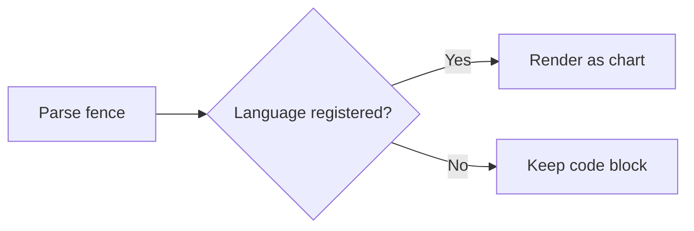

# Chart Blocks

Any Markdown body can embed charts using fenced code blocks: `mermaid` for flowcharts, sequence diagrams, and Gantt charts; `echarts` for data charts. The reading view renders them as graphics, while edit mode still shows the source code. Both chart types automatically follow the app's light/dark theme.

Documents, Wiki, memos, tasks, and decisions all use the same rendering chain, so these blocks work in any body.

## Flowcharts: mermaid

````markdown

````

## Chart Engine Switch (Pele / Mermaid)

Which engine renders mermaid diagrams is now **switchable**, no longer hard-wired:

- **Pele** (default): open-sourced by the Obsidian team, renders Mermaid 12.1.0 syntax to SVG, zero dependencies; lines and arrows adapt automatically to the theme (dark-mode contrast has been fixed).
- **Mermaid 11.16.1**: kept as an optional fallback engine.

Switch in the Web settings page under **Diagram Engine** (Pele default / Mermaid); the choice is persisted to project configuration (`diagram_engine`, default `pele`) and remains effective after restarting the browser. Both engines affect only Mermaid diagram rendering; ECharts data charts are unaffected.

> Want ready-made Mermaid templates? See document `doc-32 Mermaid Chart Gallery`—18 categories, 25 directly copyable complex examples (flowcharts, sequence diagrams, class diagrams, Gantt charts, ER diagrams, user journeys, mind maps, XY charts, architecture diagrams, etc.), covering project workflows and WeChat/Alipay scenarios.

## Data Charts: echarts

The body is standard ECharts option **JSON**; no new dialect to learn:

````markdown
```echarts
{
  "title": { "text": "Tasks completed per week" },
  "tooltip": { "trigger": "axis" },
  "legend": {},
  "xAxis": { "type": "category", "data": ["W1", "W2", "W3", "W4"] },
  "yAxis": { "type": "value" },
  "series": [
    { "name": "Completed", "type": "bar", "data": [10, 18, 25, 33] },
    { "name": "New", "type": "line", "smooth": true, "data": [14, 20, 22, 30] }
  ]
}
```
````

The same `series` array can mix multiple chart types; the above is a bar chart overlaid with a line chart.

## Supported Chart Types

Available values for `series[].type`:

| Category | Types |
|----------|-------|
| Cartesian | `bar` `line` `scatter` `effectScatter` `candlestick` `boxplot` `heatmap` `pictorialBar` `themeRiver` |
| Proportion and flow | `pie` `funnel` `sankey` |
| Hierarchy and relationships | `tree` `treemap` `sunburst` `graph` `chord` |
| Multi-dimensional and gauges | `radar` `parallel` `gauge` `lines` |

Two exceptions require extra conditions and are not built into the engine:

- `custom` depends on a `renderItem` **function**, which JSON cannot express; writing it produces only an empty chart.
- `map` requires GeoJSON registration first, and map data must come from compliant sources, so it is explicitly integrated by the user.

The default coordinate system is Cartesian `xAxis` / `yAxis`; `polar`, `singleAxis`, `calendar`, `parallel`, and `geo` components are all registered. `themeRiver` must be paired with `singleAxis`, and `type` must be `"time"`, otherwise the river bands do not appear.

## Charts Directly from Query Results: view: echarts

Query blocks can **draw results directly** instead of showing a table. `sqlite-query`, `duckdb-query`, and `cypher-query` all support this by adding `view: echarts` and a `chart` field:

````markdown
```sqlite-query
source: backlog/databases/demo-shop.sqlite
view: echarts
chart: { "type": "bar", "categoryField": "category", "valueField": "revenue", "title": "Revenue by category" }
sql: |
  SELECT category, ROUND(SUM(amount), 2) AS revenue
  FROM order_details GROUP BY category ORDER BY revenue DESC
```
````

Simple mapping fields:

| Field | Description |
|-------|-------------|
| `type` | `bar` / `line` / `pie` / `scatter` / `effectScatter` |
| `categoryField` | Category column; for `pie`, used as sector name |
| `valueField` | Value column |
| `title` / `name` | Chart title / series name, optional |
| `categoryAxisName` / `valueAxisName` | Axis names, optional |

For multi-series, dual axes, or custom styles, use the advanced form: write `option` inside `chart` and use placeholders for data positions.

````markdown
```sqlite-query
source: backlog/databases/demo-shop.sqlite
view: echarts
chart: |
  {
    "option": {
      "title": { "text": "Monthly revenue" },
      "tooltip": { "trigger": "axis" },
      "xAxis": { "type": "category", "data": "@result:month" },
      "yAxis": { "type": "value" },
      "series": [{ "type": "bar", "data": "@result:revenue" }]
    }
  }
sql: |
  SELECT substr(ordered_at, 1, 7) AS month, ROUND(SUM(amount), 2) AS revenue
  FROM order_details GROUP BY month ORDER BY month
```
````

Two placeholders:

| Placeholder | Replaced with |
|-------------|---------------|
| `"@result"` | The entire result set, one `{column: value}` object per row; suitable for `dataset.source` |
| `"@result:<column>"` | Array of values for that column; suitable for `series.data` / `xAxis.data` |

Placeholders must appear as **whole values**, not concatenated into strings; writing a wrong column name yields an empty array.

## Referencing Named Query Blocks: fromQuery

When you want both a table and a chart, give the query block an `id`, then reference it from a separate `echarts` block:

````markdown
```sqlite-query
id: monthly
source: backlog/databases/demo-shop.sqlite
sql: |
  SELECT substr(ordered_at, 1, 7) AS month, ROUND(SUM(amount), 2) AS revenue
  FROM order_details GROUP BY month ORDER BY month
```

```echarts
{
  "dataset": { "fromQuery": "monthly" },
  "tooltip": { "trigger": "axis" },
  "xAxis": { "type": "category" },
  "yAxis": { "type": "value" },
  "series": [{ "type": "bar", "encode": { "x": "month", "y": "revenue" } }]
}
```
````

You can also put the reference on the series itself, directly specifying which two columns to use:

```json
{ "type": "bar", "fromQuery": "monthly", "categoryField": "month", "valueField": "revenue" }
```

`categoryField` / `valueField` are only column-selection instructions on the referencing side and do not remain in the final configuration. When the option has no `xAxis`, the engine automatically adds a category axis using the first successfully parsed series's `categoryField`.

## Usage Conventions

| Aspect | Behavior |
|--------|----------|
| Theme | Automatically follows light/dark mode; no configuration needed |
| Loading | ECharts is loaded on demand, not in the initial bundle |
| JSON limitation | Only JSON is parsed; function expressions are not executed. Use template strings for dynamic text, such as `"{b}: {c}"` |
| Error behavior | On invalid JSON, unknown series type, or missing required fields, the block shows an error or falls back to a code block; it does not crash |
| Reference scope | `fromQuery` is only valid **within the same document**; duplicate `id`s use the last one |
| Refresh linkage | When a referenced query re-runs, the chart referencing it automatically redraws; charts without `fromQuery` are unaffected |

For complete chart examples, including copyable configurations and pitfalls for each series type, see document `doc-31 ECharts Chart Demo`; copy templates for Mermaid diagrams are in document `doc-32 Mermaid Chart Gallery`.

## Related

- [SQL Query Blocks](02-SQL查询块.md) — fields and read-only constraints for `sqlite-query` / `duckdb-query`
- [Cypher Query Blocks](04-Cypher查询块.md) — graph database query blocks, also support `view: echarts`
- [Legend Configuration Persistence](05-图例配置持久化.md) — color and legend settings for graph views
