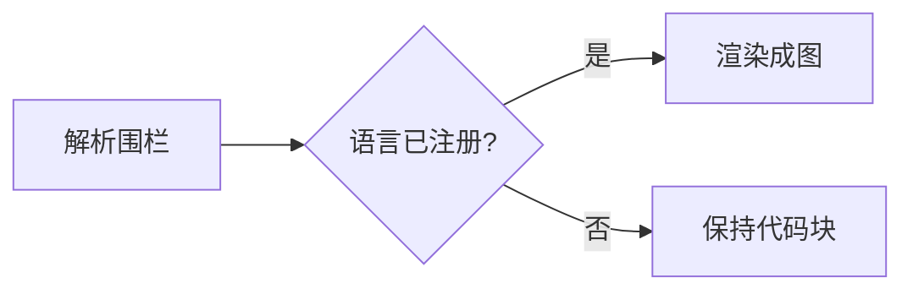

# 图表块

任何 Markdown 正文都能用围栏代码块嵌入图表：`mermaid` 画流程图、时序图、甘特图，`echarts` 画数据图。阅读视图把它渲染成图，编辑模式仍显示源码；两种图都自动跟随应用的明暗主题。

文档、Wiki、备忘、任务与决策的正文都走同一条渲染链，所以这些块在任何正文里都能用。

## 流程图：mermaid

````markdown

````

## 数据图：echarts

正文是一段标准 ECharts option 的 **JSON**，不需要学新的方言：

````markdown
```echarts
{
  "title": { "text": "每周完成任务" },
  "tooltip": { "trigger": "axis" },
  "legend": {},
  "xAxis": { "type": "category", "data": ["W1", "W2", "W3", "W4"] },
  "yAxis": { "type": "value" },
  "series": [
    { "name": "完成", "type": "bar", "data": [10, 18, 25, 33] },
    { "name": "新增", "type": "line", "smooth": true, "data": [14, 20, 22, 30] }
  ]
}
```
````

同一个 `series` 数组里可以混排多种图，上面就是柱状图叠加折线图。

## 支持的图表类型

`series[].type` 可用的值：

| 类别 | 类型 |
|---|---|
| 直角坐标 | `bar` `line` `scatter` `effectScatter` `candlestick` `boxplot` `heatmap` `pictorialBar` `themeRiver` |
| 比例与流向 | `pie` `funnel` `sankey` |
| 层级与关系 | `tree` `treemap` `sunburst` `graph` `chord` |
| 多维与仪表 | `radar` `parallel` `gauge` `lines` |

两个例外需要额外条件，引擎不内置：

- `custom` 依赖 `renderItem` **函数**，JSON 表达不了，写了也只会得到空图。
- `map` 需要先注册 GeoJSON，且地图数据必须来自合规来源，所以由使用方显式接入。

坐标系统默认是直角坐标 `xAxis` / `yAxis`；`polar`、`singleAxis`、`calendar`、`parallel`、`geo` 组件都已注册。`themeRiver` 必须配 `singleAxis`，且 `type` 要写成 `"time"`，否则不出河流带。

## 图表直接吃查询结果：view: echarts

查询块可以把结果**直接画成图**，不再显示表格。`sqlite-query`、`duckdb-query`、`cypher-query` 都支持，加 `view: echarts` 与 `chart` 字段即可：

````markdown
```sqlite-query
source: backlog/databases/demo-shop.sqlite
view: echarts
chart: { "type": "bar", "categoryField": "category", "valueField": "revenue", "title": "各类目成交额" }
sql: |
  SELECT category, ROUND(SUM(amount), 2) AS revenue
  FROM order_details GROUP BY category ORDER BY revenue DESC
```
````

简单映射形式的字段：

| 字段 | 说明 |
|---|---|
| `type` | `bar` / `line` / `pie` / `scatter` / `effectScatter` |
| `categoryField` | 类目列；`pie` 用它作扇区名 |
| `valueField` | 数值列 |
| `title` / `name` | 图表标题 / 系列名，可选 |
| `categoryAxisName` / `valueAxisName` | 轴名，可选 |

需要多系列、双轴或自定义样式时用高级形式：`chart` 里写 `option`，数据位置用占位符。

````markdown
```sqlite-query
source: backlog/databases/demo-shop.sqlite
view: echarts
chart: |
  {
    "option": {
      "title": { "text": "月度成交额" },
      "tooltip": { "trigger": "axis" },
      "xAxis": { "type": "category", "data": "@result:month" },
      "yAxis": { "type": "value" },
      "series": [{ "type": "bar", "data": "@result:revenue" }]
    }
  }
sql: |
  SELECT substr(ordered_at, 1, 7) AS month, ROUND(SUM(amount), 2) AS revenue
  FROM order_details GROUP BY month ORDER BY month
```
````

两个占位符：

| 占位符 | 替换为 |
|---|---|
| `"@result"` | 整个结果集，每行一个 `{列名: 值}` 对象，适合 `dataset.source` |
| `"@result:<列名>"` | 该列的值数组，适合 `series.data` / `xAxis.data` |

占位符必须**整值**出现，不能拼在字符串里；写错列名会得到空数组。

## 引用命名查询块：fromQuery

想让表格和图表并存时，给查询块一个 `id`，再用独立的 `echarts` block 引用它：

````markdown
```sqlite-query
id: monthly
source: backlog/databases/demo-shop.sqlite
sql: |
  SELECT substr(ordered_at, 1, 7) AS month, ROUND(SUM(amount), 2) AS revenue
  FROM order_details GROUP BY month ORDER BY month
```

```echarts
{
  "dataset": { "fromQuery": "monthly" },
  "tooltip": { "trigger": "axis" },
  "xAxis": { "type": "category" },
  "yAxis": { "type": "value" },
  "series": [{ "type": "bar", "encode": { "x": "month", "y": "revenue" } }]
}
```
````

也可以把引用写在 series 上，直接指定取哪两列：

```json
{ "type": "bar", "fromQuery": "monthly", "categoryField": "month", "valueField": "revenue" }
```

`categoryField` / `valueField` 只是引用侧的取列指令，不会留在最终配置里。option 没有 `xAxis` 时，引擎会用第一个解析成功的 series 的 `categoryField` 补一条类目轴。

## 使用约定

| 事项 | 行为 |
|---|---|
| 主题 | 自动跟随明暗模式，无需配置 |
| 加载 | ECharts 按需加载，不进首屏包 |
| JSON 限制 | 只解析 JSON，函数表达式不会执行；动态文本用模板串，如 `"{b}: {c}"` |
| 出错表现 | JSON 非法、series 类型未知、必填字段缺失时，块内显示错误或回退为代码块，不会崩 |
| 引用作用域 | `fromQuery` 只在**同一篇文档**内有效，重复 `id` 会以后写者为准 |
| 刷新联动 | 被引用的查询重跑后，引用它的图表自动重绘；没用 `fromQuery` 的图表不受影响 |

完整的图表示例，包括每种系列的可复制配置与坑位说明，见文档 `doc-31 ECharts 图表演示`。

## 相关

- [SQL 查询块](02-SQL查询块.md) — `sqlite-query` / `duckdb-query` 的字段与只读约束
- [Cypher 查询块](04-Cypher查询块.md) — 图库查询块，同样支持 `view: echarts`
- [图例配置持久化](05-图例配置持久化.md) — 图视图的配色与图例设置
