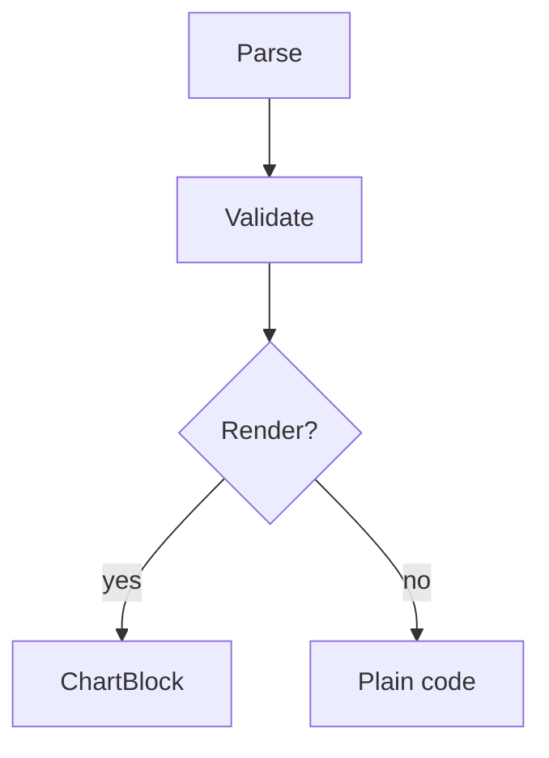

## Document Management (CLI)

Documents live under `backlog/docs/` and are used for long-term project reference information such as development standards, configuration guides, architecture documentation, and runbooks. They differ from `tasks/` (specific work items), `decisions/` (decision records), and `drafts/` (draft ideas).

Documents (like any markdown body rendered by the Web UI) can embed **live query blocks** — SQL blocks (`sqlite-query` / `duckdb-query`) that execute against project-local SQLite / DuckDB / CSV / XLSX data sources, and Cypher blocks (`cypher-query`) that execute against the project's graph databases — and render results in the reading view. See [Live SQL Query Blocks](#live-sql-query-blocks-sqlite-query--duckdb-query) and [Live Cypher Query Blocks](#live-cypher-query-blocks-cypher-query) below before writing one.

Documents can also embed **Mermaid and ECharts chart blocks**: a `mermaid` fenced block for diagrams such as flowcharts, sequence diagrams, gantt charts and state machines, and an `echarts` fenced block for data charts, whose body is a standard ECharts `option` written as JSON. Every built-in series type is available from that one fence language — bar, line, pie, scatter, radar, heatmap, gauge, funnel, sankey, tree, treemap, sunburst, graph, candlestick, boxplot, themeRiver and more. Both render in the reading view and follow the app's light/dark mode. A query block can draw its own chart instead of a table with `view: echarts`, and an `echarts` block can bind a named query block with `fromQuery` — see [Mermaid and ECharts Chart Blocks](#mermaid-and-echarts-chart-blocks) below before writing one.

Documents also support **rich links**: in-document heading anchors for a table of contents, short aliased links to backlog items (`/task/506`, `/documentation/001`, `/decisions/042`, `/wiki/...`) including `:LINE` / `:START-END` suffixes that open the target scoped to specific lines, and project-relative code file links that open a file preview — see [Links in Documents](#links-in-documents) below before referencing other items or files.

Always use Backlog.md CLI commands to create and update documents so IDs, frontmatter, paths, and search metadata stay consistent. Avoid editing document markdown files directly, except when adding complex content that cannot be safely passed through shell arguments (see [Complex content with backticks](#complex-content-with-backticks-or-shell-sensitive-characters) below).

### Document Commands

| Action | Command |
|--------|---------|
| Create a document | `backlog doc create "API Guidelines"` |
| Create in a subdirectory | `backlog doc create "Setup Guide" -p guides/setup` |
| Specify document type | `backlog doc create "Architecture" -t guide` |
| Replace document content | `backlog doc update doc-1 --content "Updated markdown"` |
| Append content to a document | `backlog doc update doc-1 --append-content "Additional section"` |
| Update metadata or move a doc | `backlog doc update doc-1 --title "Setup Handbook" -t guide --tags setup,runbook -p guides` |
| List all documents | `backlog doc list` / `backlog doc list --plain` / `backlog doc list --json` |
| View a document | `backlog doc view 1` / `backlog doc view doc-1` / `backlog doc view subdir/doc-1` / `backlog doc view Title` / `backlog doc view "doc-1 - Title.md"` / `backlog doc view 1 --plain` |

### Listing Documents

`backlog doc list` opens an interactive two-pane browser by default. The left pane shows the document list (`Documents (N)`), the right pane shows details for the selected document. Use `←/→` to switch panes, `↑/↓` or `j/k` to navigate the active pane, `Enter` to open the full document viewer from the details pane, and `q` to quit.

Pass `--plain` to print one document per line (`id - title`) for scripts and pipes. Pass `--json` for a versioned machine-readable JSON envelope. When stdout is not a TTY, plain output is emitted automatically.

Paging works here as it does on every list command: `--limit <n>` caps the list silently, and `--max-count <n>`, `--skip <n>` and `--count` page it. A window applies after filtering and sorting, in the order the output prints, so consecutive windows join into the complete output. A cut list ends with `Showing <first>-<last> of <total> items. Next: backlog doc list --max-count <n> --skip <m>`; run that command for the following documents and stop when the footer has no `Next:` part. `--count` prints only how many documents match and cannot be combined with `--json` — a window option also forces text, so no interactive browser opens.

### Viewing Documents

`backlog doc view <docId>` opens an interactive scrollable viewer by default. Pass `--plain` to print the raw document content to stdout instead (useful for agents, scripts, pipes, and CI). When stdout is not a TTY, plain output is emitted automatically, so scripts never get trapped in the interactive viewer.

For example `backlog/docs/subdir/doc-1 - Title.md`. The `<docId>` reference may take several forms. The most basic is the bare document ID: `backlog doc view 1` or `backlog doc view doc-1`. The other forms are:

- Code-name short path: `backlog doc view subdir/doc-1`
- Title: `backlog doc view Title`
- Full filename (quote when it contains spaces): `backlog doc view "doc-1 - Title.md"`

When several files share the referenced ID, path stem, or title, the command fails closed: it prints all matching candidates instead of picking one, together with ready-to-run `backlog doc view` alternatives for each candidate. Use the code-name short path form to disambiguate documents that legitimately share an ID in different subdirectories.

### Document Types

Supported values for `--type`:

- `readme`
- `guide`
- `specification`
- `other`

### Multi-line Content

`--content` and `--append-content` support `\n` escape sequences inside a quoted argument. This is the preferred form for AI agents because it works across most shells and agent harnesses.

```bash
# Replace with multi-line markdown
backlog doc update doc-1 --content "# Heading\n\nFirst paragraph.\n\nSecond paragraph."

# Append a multi-line block
backlog doc update doc-1 --append-content "## New section\n\n- Bullet one\n- Bullet two"
```

You can also repeat `--append-content` to add several blocks at once. Each value is appended as a separate block separated by a blank line from the existing content:

```bash
backlog doc update doc-1 \
  --append-content "First new block" \
  --append-content "Second new block"
```

### Combining `--content` and `--append-content`

When both flags are provided, `--content` replaces the body first and `--append-content` blocks are appended after it:

```bash
backlog doc update doc-1 \
  --content "Replacement body" \
  --append-content "Extra section"
```

### Complex content with backticks or shell-sensitive characters

If the markdown body contains backticks (`` `` ``) or other characters that the shell interprets, passing it through `--content` or `--append-content` is unsafe: the shell treats text inside backticks as a command substitution and tries to execute it, which usually fails. In that case:

1. Create the document without content:
   ```bash
   backlog doc create "API Guidelines"
   ```
2. Use a text editor or file-writing tool to append the body to the generated file under `backlog/docs/`.
3. Write the markdown **after** the YAML frontmatter block (the `---` delimited header at the top). Do not remove the frontmatter block. You may overwrite the frontmatter contents if needed, but keep the block itself intact.

This avoids shell escaping issues while still keeping the document's frontmatter intact.

### Links in Documents

Documents can contain two kinds of links: in-document heading links (table of contents) and links to other backlog items (tasks, docs, decisions, drafts, wiki pages).

#### In-document heading links

Use hash-only links (`[text](#heading)`) to jump to headings within the same document. The renderer resolves them against the current document context.

Supported anchor formats:

1. **Prefix anchor** (simplest, recommended for section-prefixed headings):
   ```markdown
   - [A1: Section Title](#A1)
   ## A1: Section Title
   ```

2. **Angle-bracket full-title anchor** (use when the heading text contains spaces or special characters):
   ```markdown
   - [A1: Section Title](<#A1: Section Title>)
   ## A1: Section Title
   ```
   Standard markdown does not allow spaces in plain link URLs, so the angle brackets are required for full titles.

3. **Github-slugger slug** (what the Web UI stores after saving):
   ```markdown
   - [A1: Section Title](#a1-section-title)
   ## A1: Section Title
   ```

Editing behavior:
- **Direct file editing**: keep the human-readable prefix or angle-bracket form. The renderer resolves both.
- **Web UI editing**: when a document is saved through the Web UI, human-readable hash anchors are automatically rewritten to the github-slugger slug form so the saved source is standard markdown while the heading text stays unchanged.

#### Local backlog links

Local paths to other backlog surfaces are automatically rendered as short aliases and open the target modal or page. This keeps documents readable even when referencing tasks, decisions, drafts, or wiki pages. The title slug is optional and ignored when generating the alias; use the ID-only path form for simplicity.

Supported patterns:

| Path pattern | Default alias | Opens |
|-------------|------------|-------|
| `/task/:id` (with optional `/:title`) | `TASK#:id` | Task modal |
| `/draft/:id` (with optional `/:title`) | `DRAFT#:id` | Draft modal |
| `/documentation/:id` (with optional `/:title`) | `DOC#:id` | Document modal |
| `/decisions/:id` (with optional `/:title`) | `Decisions#:id` | Decision modal |
| `/wiki/:path` | `WIKI#:path` | Wiki page |

When the link text is empty, the renderer fills in the default alias. If you provide a custom label, that label is shown instead.

Recommended examples (ID-only):
```markdown
- See [TASK#506](/task/506) for background.
- Read [DOC#001](/documentation/001) first.
- Check [Decisions#042](/decisions/042) for the related decision.
- Alias left empty: see [](/task/506) for the default alias.
```

When rendered, the links above display as `TASK#506`, `DOC#001`, `Decisions#042`, and `TASK#506` respectively, while remaining clickable. Only same-origin paths are transformed; external URLs are left unchanged.

##### Line suffix

Append `:LINE` or `:START-END` to the id to open the target scoped to those lines instead of navigating. The migration classification document uses this form to point at the matching section of the analysis report: `[doc-13 CORE-19](/documentation/13:319-329)`.

```markdown
- [doc-13 CORE-19](/documentation/13:319-329) opens the analysis report at lines 319-329.
- [BACK-650](/task/650:30) opens the task at line 30.
- Alias left empty: [](/documentation/13:319) renders the default alias `DOC#13:319`.
```

Rules:

- The suffix belongs to the id segment, so an optional title slug still follows it: `/documentation/13:319-329/migration-analysis`.
- A link with a custom label keeps that label. A link without a label renders the default alias with the range appended: `DOC#13:319-329`, `TASK#650:30`.
- Clicking a suffixed link opens the preview modal scoped to those lines instead of navigating, and the modal title shows the range; a link without a suffix behaves as before.
- Links rendered by views that only navigate — a decision page, or the file preview modal itself — ignore the suffix and keep navigating.
- A relative project path such as `src/file-system/operations.ts` is **not** a short local link and gets no alias: it stays a code file link, where the same suffix scopes the file preview instead (see below).

**Code file links.** A link destination can be an external URL (left unchanged), a backlog item path such as `/task/506`, or a project-relative file path. A code file link carries the same `:LINE` / `:START-END` suffix, and the file preview opens at those lines — a single line or a multi-line range:

```markdown
- [sanitizeFilename](src/file-system/operations.ts:1811-1822) opens that function.
- [readProjectFile](src/file-system/operations.ts:2183) opens a single line.
- [operations.ts](src/file-system/operations.ts) opens the whole file, when the line is not the point.
```

An item link opens the item modal; a code file link opens the file preview. Add the suffix whenever the reader only needs part of a file — a bare path opens it from line 1.

### Searching Documents

`backlog doc search <query>` lists matches across the document tree with id, title, path, type, tags, score, and a follow-up `backlog doc view` command for each hit. Add `--plain` for one line per hit, or `--json` for a versioned envelope. Paging works as it does on `doc list`: `--limit <n>` caps the list silently, and `--max-count <n>`, `--skip <n>` and `--count` page it. A cut list ends with `Showing <first>-<last> of <total> items. Next: backlog doc search <query> --max-count <n> --skip <m>`; run that command for the following hits and stop when the footer has no `Next:` part. `--count` prints only how many documents match and cannot be combined with `--json`.

### Live SQL Query Blocks: `sqlite-query` / `duckdb-query` / `mdb-query`

Any markdown body rendered by the Web UI (documents, tasks, decisions, memos, wiki pages) can embed a **live** SQL query with a `sqlite-query`, `duckdb-query` or `mdb-query` fenced code block. In the reading view the block executes against the data source and renders the result; in the editor it stays raw source and never executes. An `mdb-query` block queries a Microsoft Access (`.mdb` / `.accdb`) file — see [Live MDB Query Blocks](#live-mdb-query-blocks-mdb-query) below. A `cypher-query` block does the same for the project's graph databases — see [Live Cypher Query Blocks](#live-cypher-query-blocks-cypher-query) below.

````markdown
```sqlite-query
source: backlog/databases/shop.sqlite
view: table
sql: |
  SELECT product, price, stock
  FROM inventory
  ORDER BY price DESC
```
````

Fields are top-level `key: value` pairs; use the `sql: |` block scalar for multi-line SQL:

| Field | Required | Default | Notes |
|-------|----------|---------|-------|
| `source` | yes | — | Project-root-relative path to the data source |
| `sql` | yes | — | A single `SELECT` or `WITH ... SELECT` statement |
| `view` | no | `table` | `table` (grid) / `list` (key-value per record) / `value` (first cell of the first row, inline — good for a single metric) / `echarts` (draw the result as a chart — see [Mermaid and ECharts Chart Blocks](#mermaid-and-echarts-chart-blocks)) |
| `chart` | no | — | `view: echarts` only: the JSON chart config (see [Mermaid and ECharts Chart Blocks](#mermaid-and-echarts-chart-blocks)) |
| `id` | no | — | Optional name a standalone `echarts` block references via `fromQuery` (see [Mermaid and ECharts Chart Blocks](#mermaid-and-echarts-chart-blocks)) |
| `refresh` | no | `manual` | Manual refresh only; no auto/scheduled refresh |
| `copy_to` | no | — | `duckdb-query` only: project-relative `.csv` / `.xlsx` target that enables the write path (see below) |

Data sources:

- `sqlite-query`: `.sqlite` / `.sqlite3` / `.db` files anywhere inside the project directory.
- `duckdb-query`: `.duckdb` files, plus CSV / Excel data sources (`.csv` / `.xlsx`). For CSV/XLSX the block opens an in-memory instance and the SQL reads the file directly:
- `mdb-query`: `.mdb` / `.accdb` (Microsoft Access) files anywhere inside the project directory.

  ````markdown
  ```duckdb-query
  source: backlog/databases/orders.csv
  sql: SELECT * FROM 'backlog/databases/orders.csv'
  ```
  ````

  ````markdown
  ```duckdb-query
  source: backlog/databases/products.xlsx
  sql: SELECT * FROM read_xlsx('backlog/databases/products.xlsx', sheet = 'Sheet2')
  ```
  ````

  The official `excel` extension autoloads on first use — never write `INSTALL` / `LOAD` yourself (both are rejected). `source` stays required for CSV/XLSX and must match the file the SQL reads: it is the security anchor the path gates are checked against.

Rules (fail-closed — a violation renders an error inside the block and never affects the rest of the page):

- `source` must be project-root-relative: no leading `/`, no absolute paths / drive letters / UNC / URLs / `~`, no `..` escape, no symlinks pointing outside the project. Files under ignored directories (`node_modules`, `.git`, `dist`, `build`, `.locks`, dot-directories except `.backlog`) are rejected.
- SQL must be read-only: a single `SELECT` / `WITH ... SELECT`, no internal semicolons (one trailing `;` is tolerated and stripped). Write keywords (`INSERT` / `UPDATE` / `DELETE` / `CREATE` / `DROP` / `ATTACH` / `COPY` / `PRAGMA` / `INSTALL` / `LOAD` / ...) are rejected by static validation before the engine runs, and the engine itself is opened read-only as the final guarantee.
- SQL string literals containing `http(s)://` / `s3://` URLs are rejected; local file paths inside literals must pass the same project gates as `source`.
- Results are capped at 500 rows and flagged as truncated beyond that; there is no pagination — tighten the SQL instead.
- `copy_to` (DuckDB only) wraps the block's `SELECT` in `COPY (<sql>) TO '<target>'` and writes a new `.csv` / `.xlsx` file inside the project on every run (idempotent overwrite; the block shows "written to: <path>"). The target passes the same project gates and can never be a `.duckdb` file — the database itself always stays read-only. A `sqlite-query` block carrying `copy_to` is rejected.
- DuckDB values render coerced: BIGINT → decimal text, DECIMAL → scaled decimal string, TIMESTAMP / DATE → ISO strings, BLOB → `<blob N bytes>` placeholder, NULL → empty cell.

Writing CSV / Excel output (`duckdb-query` only): add the `copy_to` field to export the query result as a new project-local file every time the block runs:

````markdown
```duckdb-query
source: backlog/databases/shop.duckdb
view: table
copy_to: output/category-revenue.csv
sql: |
  SELECT category,
         COUNT(*)              AS orders,
         ROUND(SUM(amount), 2) AS revenue
  FROM order_details
  GROUP BY category
  ORDER BY revenue DESC
```
````

The server wraps the `SELECT` in `COPY (<sql>) TO '<target>'` (`.csv` → `HEADER TRUE`; `.xlsx` → `FORMAT XLSX, HEADER TRUE`), overwrites the target idempotently, and the block shows "written to: <path>". The written file stays inside the project, so it can itself become the `source` of another query block.

#### Live MDB Query Blocks: `mdb-query`

A Microsoft Access file (`.mdb` / `.accdb`) can be queried with a **live** `mdb-query` fenced block. The file is read with `mdb-reader` and loaded into an in-memory SQLite database, so the same SQL surface as `sqlite-query` applies — and joins across tables work. In the reading view the block executes and renders the result; in the editor it stays raw source and never executes.

````markdown
```mdb-query
source: backlog/assets/sample.mdb
view: table
sql: |
  SELECT "检查大类", COUNT(*) AS c
  FROM "*数据质量评估统计表"
  GROUP BY "检查大类"
```
````

Data sources:

- `mdb-query`: `.mdb` / `.accdb` (Microsoft Access) files anywhere inside the project directory.

Rules (in addition to the shared ones above):

- Table and column names coming from Access often contain spaces, Chinese characters or a leading `*`, so quote them with double quotes in SQL (e.g. `"表名"`); the engine is SQLite.
- `copy_to` is **not** supported — an `mdb-query` block carrying it is rejected. The original file is always read-only, and the in-memory copy is `query_only`-guarded, so a block can never write it.
- Results are preview-capped at 500 rows and flagged truncated beyond that; pagination is available, so a large table can be browsed without raising the preview cap. Value coercion is identical to `sqlite-query`.


#### Live Cypher Query Blocks: `cypher-query`

Any markdown body rendered by the Web UI can also embed a **live** Cypher query with a `cypher-query` fenced code block, executed against the project's graph databases — the `default` corpus graph (tasks, docs, decisions, memos and their dependencies / links) or a user database created with `backlog graph create`. In the reading view the block executes and renders the result; in the editor it stays raw source and never executes.

````markdown
```cypher-query
source: default
view: table
query: |
  MATCH (t:FileNode)-[:DependsOn]->(d:FileNode)
  RETURN t.id AS task, d.id AS dependency
  ORDER BY task
  LIMIT 20
```
````

The grammar is the same tiny YAML subset with two deliberate differences: the statement field is `query` (not `sql`), and `source` is a **database registry name** (what `backlog graph list` prints, e.g. `default` or `people`), never a path.

| Field | Required | Default | Notes |
|-------|----------|---------|-------|
| `source` | yes | — | Registered graph database name; an unknown name fails the block |
| `query` | yes | — | A single read-only statement: `MATCH` / `RETURN` / `WITH` / `CALL` |
| `view` | no | `table` | `table` / `list` / `value` as above, plus `graph` — a force-directed node/relationship drawing rendered by the same pane as the Databases page, reusing that database's legend configuration — and `echarts` (draw the result as a chart — see [Mermaid and ECharts Chart Blocks](#mermaid-and-echarts-chart-blocks)) |
| `chart` | no | — | `view: echarts` only: the JSON chart config (see [Mermaid and ECharts Chart Blocks](#mermaid-and-echarts-chart-blocks)) |
| `id` | no | — | Optional name a standalone `echarts` block references via `fromQuery` (see [Mermaid and ECharts Chart Blocks](#mermaid-and-echarts-chart-blocks)) |
| `refresh` | no | `manual` | `manual`, or `auto` — re-run when a graph-updated broadcast names this block's database (one re-run per burst) |
There is no `copy_to` on a `cypher-query` block — the graph engine is read-only, full stop.

The `graph` view with `refresh: auto` (the block re-runs itself when the graph changes):

````markdown
```cypher-query
source: people
view: graph
refresh: auto
query: |
  MATCH (a:Person)-[:KNOWS]->(b:Person)
  RETURN a, b
```
````

Rules (fail-closed — a violation renders an error inside the block and never affects the rest of the page):

- Read-only: write keywords (`CREATE` / `DROP` / `DELETE` / `INSERT` / `MERGE` / `SET` / `UPDATE`) are rejected by static validation before the engine runs; `CALL` stays allowed for read-only introspection (e.g. `CALL show_tables() RETURN name, type`).
- `source` must be a registered database name — names resolve through `backlog/databases/registry.json`, so a path-shaped value simply cannot match.
- Results are capped at 500 rows by default (`queryMaxRows` config, hard ceiling 5000) and flagged as truncated beyond that; there is no pagination — tighten the query instead.
- The `graph` view draws up to 3000 nodes; a larger result falls back to the coerced table with a notice.
- `refresh: auto` is opt-in: it re-runs only when a graph-updated broadcast names this block's database (a CLI / MCP write, or the corpus graph being rebuilt), coalesced into one re-run per burst; `manual` blocks re-run only via the toolbar button.
- Cells are coerced to plain scalars: nodes render as a compact JSON string, relationships and paths as `(a)-[TYPE]->(b)` text, NULL as an empty cell.
- Toolbar actions: refresh, show/hide query, copy as Markdown, export CSV. No pagination, no `copy_to`.

Because these blocks (SQL and Cypher alike) contain backticks, do not pass them through `--content` / `--append-content` — the shell would try to execute the fence text. Use the [complex content workflow](#complex-content-with-backticks-or-shell-sensitive-characters): create the document with `backlog doc create`, then write the fenced blocks into the file directly, after the frontmatter.

### Mermaid and ECharts Chart Blocks

Any markdown body rendered by the Web UI can embed a diagram or data chart with a fenced
code block. Two fence languages are supported, both rendered through the same `ChartBlock`
engine; the chart follows the app's light/dark mode automatically.

#### Mermaid

Write [Mermaid](https://mermaid.js.org) syntax inside a ` ```mermaid ` block — flowcharts,
sequence diagrams, gantt charts, state machines, and so on. This is the same engine used
everywhere else in the app, so the result looks identical.

````markdown

````

#### ECharts

Write a standard ECharts [`option`](https://echarts.apache.org/en/option.html) as **JSON**
inside a ` ```echarts ` block. Every built-in series type is available from this single
fence language — no custom dialect to learn. See doc-31 ("ECharts 图表演示", under
`docs/PRDS/echarts/`) for a live block for each type, plus the `view: echarts` and `fromQuery`
forms.

````markdown
```echarts
{
  "title": { "text": "Tasks completed by week" },
  "tooltip": {},
  "xAxis": { "type": "category", "data": ["W1", "W2", "W3", "W4"] },
  "yAxis": { "type": "value" },
  "series": [
    { "name": "done", "type": "bar", "data": [10, 18, 25, 33] }
  ]
}
```
````

- **Theme**: follows the app's light/dark mode automatically — nothing to configure.
- **Supported series** (set `series[].type`): `bar`, `line`, `pie`, `scatter`, `effectScatter`,
  `radar`, `heatmap`, `gauge`, `funnel`, `sankey`, `tree`, `treemap`, `sunburst`, `graph`,
  `map`, `parallel`, `candlestick`, `boxplot`, `lines`, `pictorialBar`, `themeRiver`,
  `custom`, `chord` (ECharts 6). Combine several series (e.g. a `bar` + a `line`) by adding
  more entries to `series`.
- **Coordinate systems**: cartesian (`xAxis`/`yAxis`) is the default; `polar`, `singleAxis`
  (required by `themeRiver`, and it must be `type: "time"`), `calendar`, `parallel` and `geo`
  are registered too. A series whose coordinate component is missing throws and leaves the
  block blank, so copy the shapes from doc-31 rather than hand-assembling them.
- **JSON only — no functions**: the option is parsed with `JSON.parse`; function expressions
  (e.g. an axis `formatter`) are not evaluated. This keeps the render free of any scripting
  surface. Use ECharts template strings (e.g. `"{b}: {c}"`) for dynamic text instead.
- **Invalid input falls back gracefully**: if the JSON does not parse (or names an unknown
  series `type`), the block renders as a plain code block instead of crashing.

#### Charts from a query-block

A query block can draw its own chart instead of a table: add `view: echarts` and a `chart` field
holding JSON. It is the query-block's version of the `value` view — the result *is* the chart, so no
separate ` ```echarts ` block or visible data-source block is needed. It works for `sqlite-query`,
`duckdb-query`, `mdb-query`, and `cypher-query` alike.

**Simple mapping form** — name the category and value columns:

````markdown
```sqlite-query
source: backlog/databases/tasks.sqlite
view: echarts
chart: |
  { "type": "bar", "categoryField": "day", "valueField": "cnt", "title": "Tasks per day" }
sql: |
  SELECT day, COUNT(*) AS cnt FROM tasks GROUP BY day ORDER BY day
```
````

`type` is any ECharts series type (`bar`, `line`, `pie`, `scatter`, …). For `pie`, `categoryField`
is the slice name and `valueField` is the slice value; for `scatter`, the two fields become the
x/y coordinates; everything else draws a category x-axis plus a value y-axis. Optional `name`
labels the series (and its legend), and `categoryAxisName` / `valueAxisName` label the axes.

**Advanced full form** — write a normal ECharts `option` under `chart.option` and reference this
query's own result with two placeholders:

| Placeholder | Injects |
|---|---|
| `@result` | the whole result as an array of column-keyed objects (`[{day, cnt}, …]`) |
| `@result:<column>` | that column's values as a flat array |

````markdown
```sqlite-query
source: backlog/databases/tasks.sqlite
view: echarts
chart: |
  {
    "option": {
      "title": { "text": "Done vs todo" },
      "tooltip": { "trigger": "axis" },
      "legend": { "data": ["done", "todo"] },
      "xAxis": { "type": "category", "data": "@result:day" },
      "yAxis": { "type": "value" },
      "series": [
        { "name": "done", "type": "bar", "data": "@result:done" },
        { "name": "todo", "type": "line", "data": "@result:todo" }
      ]
    }
  }
sql: |
  SELECT day, done, todo FROM tasks GROUP BY day
```
````

Using `dataset.source: "@result"` injects the whole table; declare which column is which axis with
`series.encode` (e.g. `{ "x": "day", "y": "cnt" }`) — the dataset fills the data, `encode` maps the
columns to axes.

- **Which form**: the advanced form is used when `chart.option` is present, the simple form
  otherwise. The two are mutually exclusive.
- **Placeholders match exactly**: a string value that is exactly `@result` or `@result:<column>` is
  replaced; anything else (including `@result:<column>` embedded in longer text) is left as-is. An
  unknown `@result:<column>` yields an empty array.
- **Still JSON-only**: `chart` is parsed with `JSON.parse`; no functions are executed. An invalid
  `chart` (bad JSON, or a simple form missing `type` / `categoryField` / `valueField`) shows an
  inline error inside the block instead of crashing.
- **`chart` shape**: either a single-line JSON string (`chart: {...}`) or a block scalar
  (`chart: |`); multi-line JSON must be indented under `chart: |` (standard YAML block-scalar rules).

#### Referencing a named query from an `echarts` block: `fromQuery`

The `view: echarts` form above draws the query's own result. To keep the query block visible (as a
table) and draw one or more separate charts from it, give the query block an `id` and reference that
id from a standalone ` ```echarts ` block with `fromQuery`.

**1. Name the query block** with an `id` (works for all three query-block types):

````markdown
```sqlite-query
id: tasks-by-day
source: backlog/databases/tasks.sqlite
sql: SELECT day, done, todo FROM tasks GROUP BY day
```
````

**2. Reference it from an `echarts` block** with `fromQuery`. Whole-dataset form uses
`dataset.source` plus `encode`:

````markdown
```echarts
{
  "dataset": { "fromQuery": "tasks-by-day" },
  "xAxis": { "type": "category" },
  "yAxis": { "type": "value" },
  "series": [{ "type": "bar", "encode": { "x": "day", "y": "done" } }]
}
```
````

Series-level field mapping is a shorthand — it fills the series `data` from `valueField` and, when
the option has no `xAxis`, adds a category axis from `categoryField`:

````markdown
```echarts
{
  "series": [{ "type": "line", "fromQuery": "tasks-by-day", "categoryField": "day", "valueField": "done" }]
}
```
````

- **Scope**: `fromQuery` resolves only against query blocks in the **same document** — the registry
  is mounted per rendered body, so an `id` can be reused in another document without colliding.
  Cross-document references are not supported.
- **Duplicate ids**: two query blocks sharing an `id` in one document collide; the later result
  overwrites the earlier and a warning is logged to the console.
- **Lifecycle**: a chart that uses `fromQuery` re-renders when its query re-runs (Refresh, or
  `refresh: auto`); before the query has produced a result it shows a "未找到查询 id" message and
  updates as soon as the result arrives.
- **Still JSON-only**: `fromQuery` is resolved by data substitution on the parsed option — no
  function is executed. An `id` that does not exist renders the message inline instead of crashing.

> Because these blocks contain JSON (and sometimes backticks), do not pass them through
> `--content` / `--append-content` — the shell would mangle the fence text. Use the
> [complex content workflow](#complex-content-with-backticks-or-shell-sensitive-characters):
> create the document with `backlog doc create`, then write the fenced blocks into the file
> directly, after the frontmatter.

### Key Rules

- Document paths are relative to `backlog/docs/`; absolute paths and `..` traversal are rejected.
- Document IDs are global across the entire docs tree, including nested subfolders.
- Use project-root-relative paths or URLs when referencing docs from tasks (`--doc docs/architecture.md`), not bare doc IDs.
- Do not edit document files directly; use `backlog doc update` so frontmatter stays valid.
